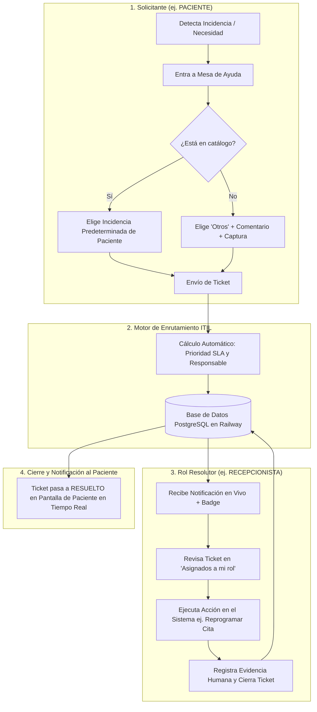

# Arquitectura de Canales de Incidencias, Mesa de Ayuda ITIL y Persistencia en Base de Datos

**Proyecto:** Coronyx Dental – Sistema Integral de Gestión Odontológica  
**Módulo:** Mesa de Ayuda, Soporte Técnico y Gestión de Incidencias (Sprint 05)  
**Estándar de Referencia:** ITIL 4 (Service Request Management & Incident Management)  
**Entorno de Producción Destino:** Railway Cloud (PostgreSQL 16 + Spring Boot 4 + Vite React)  
**Fecha de Documentación:** Octubre 2026  

---

## 1. Validación de la Visión y Flujo Operativo

**¿Es este el flujo correcto? SÍ, ABSOLUTAMENTE.**  
La propuesta de estructurar canales de incidencias por rol, filtrar opciones según el solicitante, permitir capturas en "Otros", notificar en tiempo real al resolutor y permitirle tanto resolver el ticket como ejecutar la acción en el sistema es la **arquitectura estándar de nivel empresarial**.



---

## 2. Canales de Incidencias Segmentados por Rol Solicitante

Para no confundir al usuario, el catálogo de opciones predeterminadas debe estar **filtrado según quién está registrando el ticket**:

### A. Canal del PACIENTE (Opciones concurrentes que le atañen exclusivamente)
El paciente nunca debe ver opciones internas de la clínica (como "Cese de recepcionista" o "Conflicto de sillón dental"). Solo ve:

1. **Reprogramación forzada de cita odontológica (urgencia < 2 horas):**
   * *Responsable asignado:* **Recepcionista**
   * *Tipo:* Asistencia (Solicitud de Servicio)
   * *Prioridad:* **Alta** (SLA: 20 min)
   * *Acción en sistema del resolutor:* Abrir Agenda, mover el turno del paciente y liberar el sillón anterior.
2. **Corrección de DNI o Nombre por error de digitación:**
   * *Responsable asignado:* **Admin Clínica**
   * *Tipo:* Asistencia (Seguridad de Identidad)
   * *Prioridad:* **Media** (SLA: 60 min)
   * *Acción en sistema del resolutor:* Validar contra RENIEC y actualizar en padrón de pacientes.
3. **No puedo visualizar mi receta médica o radiografía en el portal:**
   * *Responsable asignado:* **Odontólogo**
   * *Tipo:* Incidencia Operativa
   * *Prioridad:* **Media** (SLA: 30 min)
   * *Acción en sistema del resolutor:* Ir a Adjuntos del paciente y activar interruptor `esVisiblePaciente`.
4. **Falla de conexión o audio en sala de Teleodontología:**
   * *Responsable asignado:* **Soporte Técnico TI**
   * *Tipo:* Incidencia Crítica
   * *Prioridad:* **Alta** (SLA: 15 min)
   * *Acción en sistema del resolutor:* Refrescar token Jitsi/WebRTC o reemitir enlace de Google Meet.
5. **Otros / Incidencia no listada (Personalizada):**
   * *Responsable por defecto:* **Admin Clínica** (Triaje general)
   * *Habilita:* Caja de texto con descripción libre + botón para **subir captura de pantalla**.

---

### B. Canal del ODONTÓLOGO
1. Reasignación urgente de sillón por complicación o retraso en cirugía (*Resolutor: Recepcionista*).
2. Error 413 al subir radiografía panorámica pesada > 25MB (*Resolutor: Soporte Técnico TI*).
3. Solicitud de adenda o corrección en historia clínica cerrada (*Resolutor: Admin Clínica*).
4. Registro de ausencia médica por congreso o capacitación (*Resolutor: Admin Clínica*).
5. Otros (Personalizada con captura).

---

### C. Canal de la RECEPCIONISTA
1. Liberación de turno por paciente que no se presentó - No Show (*Resolutor: Recepcionista*).
2. Paciente solicita cita fuera del horario laboral de la sede (*Resolutor: Admin Clínica*).
3. Bloqueo o lentitud en el módulo de Agenda y Citas (*Resolutor: Soporte Técnico TI*).
4. Paciente consulta sobre dosificación de medicamentos emitidos (*Resolutor: Odontólogo*).
5. Otros (Personalizada con captura).

---

### D. Canal del ADMINISTRADOR DE CLÍNICA
1. Bloqueo urgente de credenciales por desvinculación laboral (*Resolutor: Admin Clínica / TI*).
2. Caída o error 500 en base de datos PostgreSQL Railway (*Resolutor: Soporte Técnico TI*).
3. Solicitud de apertura de nuevo consultorio o sillón en sede (*Resolutor: Soporte Técnico TI*).
4. Otros (Personalizada con captura).

---

## 3. Matriz Justificada de Prioridades (Impacto vs Urgencia)

Cada incidencia tiene su prioridad matemáticamente sustentada para defender ante el docente:

$$\mathbf{Prioridad} = \mathbf{Impacto\ (1\ a\ 3)} \times \mathbf{Urgencia\ (1\ a\ 3)}$$

| Nivel de Prioridad | Puntaje | Justificación Operativa | SLA Comprometido |
| :---: | :---: | :--- | :---: |
| <span style="color:#e11d48;font-weight:bold;">ALTA</span> | **6 a 9** | **Paraliza la atención en vivo o compromete la seguridad:**<br>• El paciente está esperando en sala o en línea.<br>• El sillón dental está bloqueado sin poder atender.<br>• Hay riesgo de filtración de datos de personal desvinculado. | **10 a 20 minutos** |
| <span style="color:#d97706;font-weight:bold;">MEDIA</span> | **3 a 5** | **Degrada el servicio pero permite alternativa temporal (Workaround):**<br>• Error de subida de archivo (se puede reintentar comprimido).<br>• DNI erróneo (el paciente puede ser atendido y corregir el DNI antes de facturar).<br>• Reprogramación con más de 24h de anticipación. | **30 a 60 minutos** |
| <span style="color:#64748b;font-weight:bold;">BAJA</span> | **1 a 2** | **Solicitudes administrativas o informativas planificadas:**<br>• Consultas de precios de tratamientos futuros.<br>• Solicitud de capacitaciones de inducción.<br>• Solicitudes de convenios corporativos en "Otros". | **2 a 24 horas** |

---

## 4. Flujo de Notificaciones y Doble Resolución en Tiempo Real

Para que la experiencia sea completa, la resolución consta de dos partes:

1. **Notificación al Resolutor Asignado:**
   * En cuanto el paciente crea el ticket (ej. `TKT-021`), el backend emite una notificación.
   * La **Recepcionista** ve un incremento en su campana de notificaciones y un badge en la pestaña:  
     `Mesa de Ayuda (1 ticket pendiente asignado a ti)`.
2. **Acción Operativa en el Sistema:**
   * En el ticket, la recepcionista tiene un botón directo:  
     `🔗 Ir a Agenda para Reprogramar`.
   * Al hacer clic, el sistema la lleva a la cita médica en cuestión para moverla al nuevo horario.
3. **Cierre Formal con Evidencia Humana:**
   * Vuelve a la Mesa de Ayuda y hace clic en **`Resolver`**.
   * Redacta la evidencia: *"Paciente llamado por teléfono, cita movida al día de mañana a las 10:00 am en Sillón 1"*.
   * Al confirmar, el ticket se cierra con estado **`RESUELTO`** y el paciente en su portal ve que su requerimiento fue atendido exitosamente.

---

## 5. Diseño del Modelo Físico en PostgreSQL (Migración Flyway V17)

Para que los tickets no vivan solo en la memoria y se guarden de verdad en la base de datos de PostgreSQL en Railway, se estructura la migración **`V17__helpdesk_tickets_and_attachments.sql`**:

```sql
-- 1. Tabla de Tickets de Mesa de Ayuda e Incidencias
CREATE TABLE IF NOT EXISTS mesa_ayuda_ticket (
    id VARCHAR(20) PRIMARY KEY,                         -- ej: 'TKT-001'
    solicitud TEXT NOT NULL,                            -- Título o descripción corta
    solicitante_rol VARCHAR(50) NOT NULL,               -- 'PACIENTE', 'ODONTOLOGO', etc.
    solicitante_nombre VARCHAR(150),                    -- 'Luis Paciente'
    responsable_rol VARCHAR(50) NOT NULL,               -- 'RECEPCIONISTA', 'ADMIN_CLINICA', etc.
    responsable_nombre VARCHAR(150),                    -- Asignado específico o rol
    prioridad VARCHAR(20) NOT NULL,                     -- 'ALTA', 'MEDIA', 'BAJA'
    estado VARCHAR(30) NOT NULL DEFAULT 'PENDIENTE',    -- 'PENDIENTE', 'EN_ATENCION', 'RESUELTO', 'CERRADO'
    tipo_itil VARCHAR(50) NOT NULL,                     -- 'Incidencia', 'Acceso', 'Asistencia', 'Información'
    sla_minutos INT NOT NULL DEFAULT 60,                -- SLA comprometido en minutos
    evidencia TEXT,                                     -- Evidencia de resolución humana
    fecha_registro TIMESTAMP WITHOUT TIME ZONE DEFAULT CURRENT_TIMESTAMP,
    fecha_resolucion TIMESTAMP WITHOUT TIME ZONE,
    descripcion_detallada TEXT,                         -- Comentario en caso de 'Otros'
    archivo_adjunto_url TEXT,                           -- Captura de pantalla en caso de error
    cita_id UUID REFERENCES cita(id) ON DELETE SET NULL -- Enlace opcional a la cita afectada
);

-- 2. Índices de Búsqueda Rápida para el Tablero
CREATE INDEX IF NOT EXISTS idx_mesa_ayuda_responsable ON mesa_ayuda_ticket(responsable_rol, estado);
CREATE INDEX IF NOT EXISTS idx_mesa_ayuda_solicitante ON mesa_ayuda_ticket(solicitante_rol);
CREATE INDEX IF NOT EXISTS idx_mesa_ayuda_fecha ON mesa_ayuda_ticket(fecha_registro DESC);
```

---

## 6. Despliegue en Producción en Railway Cloud

### Variables de Entorno Requeridas en Railway:
* **`DB_URL`**: `jdbc:postgresql://${{Postgres.PGHOST}}:${{Postgres.PGPORT}}/${{Postgres.PGDATABASE}}`
* **`DB_USERNAME`**: `${{Postgres.PGUSER}}`
* **`DB_PASSWORD`**: `${{Postgres.PGPASSWORD}}`
* **`SERVER_PORT`**: `8081` (o puerto dinámico asignado por Railway)
* **`CORS_ALLOWED_ORIGINS`**: `https://tudominio-frontend.up.railway.app,http://localhost:5173`

### Flujo del Despliegue:
1. Al hacer `git push` a la rama de producción, Railway ejecuta `./mvnw clean package -DskipTests`.
2. Flyway ejecuta automáticamente la migración `V17__helpdesk_tickets_and_attachments.sql`.
3. Spring Boot levanta el servicio `/api/v1/helpdesk/tickets`.
4. El Frontend en Vite consume directamente los datos persistidos en la nube.
5. **Cualquier usuario que entre desde su celular o laptop (modo normal o incógnito) verá exactamente los mismos tickets en tiempo real.**

---

## 7. Conclusión y Respaldo para el Informe del Sprint 05

Esta arquitectura responde a los 3 pilares exigidos por el docente:
1. **Canalización por Rol:** Los usuarios no se saturan con opciones ajenas a su función.
2. **Intervención Humana:** La resolución nunca es un proceso fantasma del sistema; exige un rol resolutor y un registro de evidencia.
3. **Persistencia y Disponibilidad:** Los tickets no se pierden al recargar la página ni al cambiar de navegador, respaldando auditorías de calidad en salud dental.
