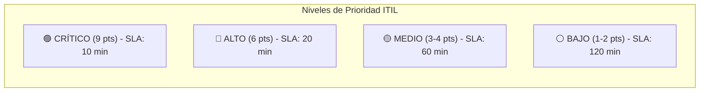
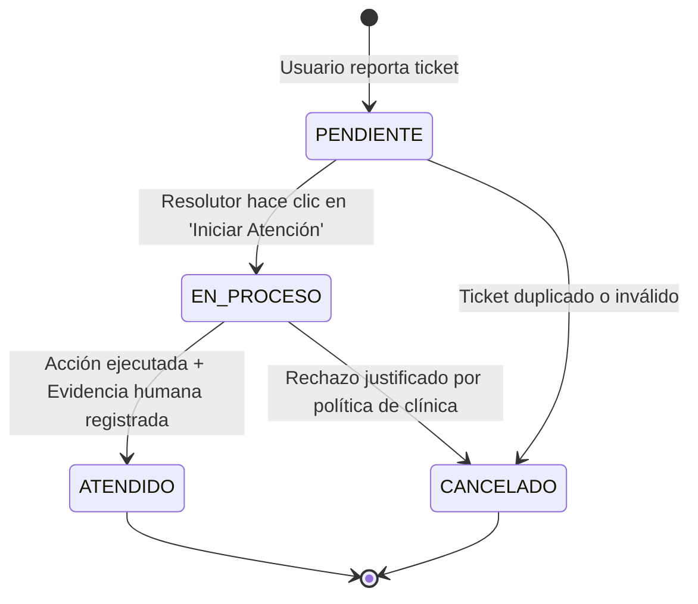

# Sustentación de Mesa de Ayuda: Matriz 3x3 de Priorización, Bitácora y Enrutamiento Operativo Directo (Sprint 05)

**Proyecto:** Coronyx Dental – Sistema Integral de Gestión Odontológica  
**Sprint:** 05 – Gestión de Incidencias y Mesa de Ayuda ITIL 4  
**Docente Revisor:** Evaluación de Sprint 05  
**Entorno de Producción:** Railway Cloud (PostgreSQL 16 + Spring Boot 4 + React Vite)  
**Fecha:** Octubre 2026  

---

## 1. Resumen Ejecutivo y Respuesta al Docente

El presente documento responde de manera formal, matemática y técnica a las observaciones planteadas por el docente para el Sprint 05:

1. **Persistencia Total en Base de Datos y Railway:**  
   Todo el catálogo de incidencias por rol, los tickets registrados y la bitácora de auditoría residen en la base de datos PostgreSQL mediante la migración versionada de Flyway **`V17__mesa_ayuda_catalogo_y_bitacora.sql`**. El despliegue continuo en Railway ejecuta esta migración automáticamente.
2. **Matriz 3x3 de Priorización (Impacto vs Probabilidad):**  
   Se eliminó la asignación arbitraria de prioridades. La prioridad se calcula objetivamente con **3 niveles de Impacto** $\times$ **3 niveles de Probabilidad**, dando como resultado **4 niveles de Prioridad:** `CRÍTICO`, `ALTO`, `MEDIO` y `BAJO`.
3. **Catálogo Preestablecido (El Solicitante NO inventa la prioridad):**  
   El solicitante (Paciente, Odontólogo, Recepcionista, Admin) solo selecciona su problema en su canal específico. El sistema ya tiene predeterminada la prioridad según la matriz de riesgo.
4. **Estados Oficiales del Ciclo de Vida ITIL:**  
   Los tickets transicionan formalmente entre 4 estados auditados:  
   `PENDIENTE` $\rightarrow$ `EN_PROCESO` $\rightarrow$ `ATENDIDO` (o `CANCELADO`).
5. **Bitácora de Auditoría ("¿Dónde está tu bitácora?"):**  
   Cada ticket cuenta con su tabla hija `mesa_ayuda_bitacora` que registra fecha, hora, estado anterior, estado nuevo, usuario que intervino, rol, acción y comentario/evidencia.
6. **PLUS: Botón de Acceso Directo Operativo en el Ticket:**  
   En tickets de reprogramación, la recepcionista dispone de un botón directo:  
   **`📅 Ir a Cita en Agenda`**, el cual abre la cita exacta en el calendario sin pasos manuales intermedios. Este mismo patrón se replica para corregir DNI (`👤 Ir a Ficha de Paciente`), revisar radiografías (`📁 Ir a Archivos`) o atender salas virtuales (`📹 Ir a Teleconsulta`).

---

## 2. La Fórmula y Matriz 3x3 de Priorización (Impacto vs Probabilidad)

### 2.1. Las Dos Variables Fundamentales
Siguiendo las directrices del docente, el riesgo de una incidencia se fundamenta en dos preguntas directas:

1. **Probabilidad ($P$ - 3 Niveles):**  
   *¿Qué tan probable es que esta situación suceda en la clínica?*
   * **Baja ($1$):** Eventos raros o mensuales (ej. fallo general de base de datos, solicitud de adenda médica).
   * **Media ($2$):** Ocurre semanalmente (ej. error al subir archivo binario pesado, paciente con DNI mal digitado).
   * **Alta ($3$):** Ocurre casi a diario (ej. paciente que llega tarde y pide reprogramar cita, o colisión de turnos en sillón).

2. **Impacto ($I$ - 3 Niveles):**  
   *¿Cuánto daño o perjuicio operativo/económico/legal causa a la clínica?*
   * **Bajo ($1$):** No interrumpe la consulta médica; informativo o planificable (ej. consulta de precios del sábado).
   * **Medio ($2$):** Degrada el servicio o afecta a un paciente específico, pero existe alternativa provisional (ej. radiografía pesada que se puede comprimir).
   * **Alto ($3$):** Paraliza por completo la atención médica en vivo o vulnera la seguridad legal/física de la sede (ej. sala virtual caída con paciente conectado, dos pacientes en el mismo sillón a la misma hora, o aula cerrada con llave).

---

### 2.2. La Matriz de Decisión $3 \times 3 \rightarrow 4$ Niveles de Prioridad

Multiplicando el valor numérico: $\text{Puntaje} = \text{Impacto} \times \text{Probabilidad}$ (de $1$ a $9$):

| Impacto \ Probabilidad | BAJA (1) | MEDIA (2) | ALTA (3) |
| :--- | :---: | :---: | :---: |
| **ALTO (3)** *(Paraliza atención)* | **MEDIO** (Puntaje 3) | <span style="color:#dc2626;font-weight:bold;">ALTO</span> (Puntaje 6) | <span style="color:#7c3aed;font-weight:bold;">CRÍTICO</span> (Puntaje 9) |
| **MEDIO (2)** *(Afecta 1 cita/sede)* | <span style="color:#475569;font-weight:bold;">BAJO</span> (Puntaje 2) | **MEDIO** (Puntaje 4) | <span style="color:#dc2626;font-weight:bold;">ALTO</span> (Puntaje 6) |
| **BAJO (1)** *(Informativo/Trámite)* | <span style="color:#475569;font-weight:bold;">BAJO</span> (Puntaje 1) | <span style="color:#475569;font-weight:bold;">BAJO</span> (Puntaje 2) | **MEDIO** (Puntaje 3) |

---

### 2.3. Definición y SLA de los 4 Niveles de Prioridad



1. <span style="color:#7c3aed;font-weight:bold;">CRÍTICO (Puntaje 9) — SLA: 10 Minutos:</span>
   * **Criterio:** Impacto Alto $\times$ Probabilidad Alta.
   * **El ejemplo del aula cerrada con llave:** Si el docente llega y el aula está con llave, la clase se suspende al 100%. En la clínica dental:
     * **Caso Real:** Caída de la sala WebRTC en plena teleconsulta con paciente en línea, o bloqueo total de base de datos en Railway.
   * **Regla de oro:** ¡Se atiende de **PRIMERO**, por encima de cualquier otro ticket!

2. <span style="color:#dc2626;font-weight:bold;">ALTO (Puntaje 6) — SLA: 20 Minutos:</span>
   * **Criterio:** Impacto Alto $\times$ Probabilidad Media, o Impacto Medio $\times$ Probabilidad Alta.
   * **Casos Reales:**
     * Conflicto de sillón dental (dos pacientes en el mismo consultorio).
     * Reprogramación forzada de cita con menos de 2 horas (el paciente está por llegar o ya en camino).
     * Desvinculación de personal con credenciales activas (riesgo de fuga de información).

3. <span style="color:#d97706;font-weight:bold;">MEDIO (Puntaje 3 a 4) — SLA: 60 Minutos:</span>
   * **Criterio:** Impacto Medio $\times$ Probabilidad Media, o Impacto Alto $\times$ Probabilidad Baja.
   * **Casos Reales:**
     * Corrección de DNI o nombres de paciente antes de emitir comprobante.
     * Error 413 al subir radiografía > 25MB (se puede reintentar comprimida).
     * Paciente no visualiza radiografía en el portal.

4. <span style="color:#475569;font-weight:bold;">BAJO (Puntaje 1 a 2) — SLA: 120 Minutos (o Programable):</span>
   * **Criterio:** Impacto Bajo o Medio $\times$ Probabilidad Baja.
   * **Casos Reales:**
     * Consulta de horarios de fin de semana o precios de tratamientos.
     * Solicitud de cotización corporativa para empresa vecina ("Otros").
     * Registro de ausencia programada por vacaciones de odontólogo.

---

### 2.4. Resolución de la Pregunta: ¿A quién atiende primero el resolutor?
Supongamos el caso expuesto por el docente:
* **Alan** reportó a las 08:00 am: *Consulta sobre horarios de sábado* (Prioridad: **BAJO**).
* **Chumbes** reportó a las 08:05 am: *Dígito de DNI mal colocado* (Prioridad: **MEDIO**).
* **Pérez** reportó a las 08:10 am: *Paciente esperando afuera y el sillón 1 está bloqueado* (Prioridad: **CRÍTICO**).

> **Respuesta Técnica:**  
> Aunque Alan reportó primero en el tiempo, el sistema **ordena la bandeja del resolutor por Nivel de Prioridad**:
> 1. **1.° a atender:** **Pérez (CRÍTICO)** ➔ Evita la paralización física del consultorio.
> 2. **2.° a atender:** **Chumbes (MEDIO)** ➔ Corrige datos antes del cierre de caja.
> 3. **3.° a atender:** **Alan (BAJO)** ➔ Consulta informativa que no bloquea a nadie.

---

## 3. Catálogo Preestablecido de Incidencias Segmentadas por Rol Solicitante

El solicitante **nunca define la prioridad ni ve incidencias ajenas a su función**. El catálogo está sembrado en la tabla `catalogo_incidencia`:

| Código | Solicitante | Incidencia Predeterminada | Prob. | Imp. | Prioridad | Rol Resolutor | SLA | Enlace Directo (PLUS) |
| :---: | :---: | :--- | :---: | :---: | :---: | :---: | :---: | :--- |
| `INC-PAC-001` | **PACIENTE** | Reprogramación urgente de cita médica (falta < 2h) | **3** | **2** | <span style="color:#dc2626;font-weight:bold;">ALTO</span> | Recepcionista | 20 min | `📅 Ir a Cita en Agenda` |
| `INC-PAC-002` | **PACIENTE** | Corrección de DNI o Nombre por error de tipeo | **2** | **2** | <span style="color:#d97706;font-weight:bold;">MEDIO</span> | Admin Clínica | 60 min | `👤 Ir a Ficha de Paciente` |
| `INC-PAC-003` | **PACIENTE** | Radiografía o receta médica no visible en portal | **2** | **2** | <span style="color:#d97706;font-weight:bold;">MEDIO</span> | Odontólogo | 30 min | `📁 Ir a Archivos de Paciente` |
| `INC-PAC-004` | **PACIENTE** | Falla de conexión a sala virtual de Teleconsulta | **3** | **3** | <span style="color:#7c3aed;font-weight:bold;">CRÍTICO</span> | Soporte TI | 10 min | `📹 Ir a Sala Virtual` |
| `INC-PAC-005` | **PACIENTE** | Consulta de horarios de sede y precios | **2** | **1** | <span style="color:#475569;font-weight:bold;">BAJO</span> | Recepcionista | 120 min | `ℹ️ Ver Horarios de Sede` |
| `INC-ODO-001` | **ODONTÓLOGO** | Reasignación urgente de sillón por retraso en cirugía | **2** | **3** | <span style="color:#dc2626;font-weight:bold;">ALTO</span> | Recepcionista | 15 min | `📅 Abrir Matriz de Sillones` |
| `INC-ODO-002` | **ODONTÓLOGO** | Error al cargar radiografía pesada (> 25MB) | **2** | **2** | <span style="color:#d97706;font-weight:bold;">MEDIO</span> | Soporte TI | 30 min | `📁 Subir Archivo Manual` |
| `INC-ODO-003` | **ODONTÓLOGO** | Solicitud de adenda a historia clínica cerrada | **1** | **2** | <span style="color:#475569;font-weight:bold;">BAJO</span> | Admin Clínica | 120 min | `🦷 Ver Odontograma/Historia` |
| `INC-REC-001` | **RECEPCIÓN** | Liberación de turno y sillón por Paciente No-Show | **3** | **2** | <span style="color:#dc2626;font-weight:bold;">ALTO</span> | Recepcionista | 15 min | `📅 Gestionar Cita No-Show` |
| `INC-REC-002` | **RECEPCIÓN** | Paciente solicita cita fuera de horario laboral | **2** | **1** | <span style="color:#475569;font-weight:bold;">BAJO</span> | Admin Clínica | 120 min | `⚙️ Ver Franja Laboral` |
| `INC-ADM-001` | **ADMIN** | Bloqueo urgente por desvinculación de personal | **1** | **3** | <span style="color:#dc2626;font-weight:bold;">ALTO</span> | Admin / TI | 15 min | `👥 Ir a Personal de Clínica` |
| `INC-ADM-002` | **ADMIN** | Caída o lentitud en base de datos Railway | **1** | **3** | <span style="color:#7c3aed;font-weight:bold;">CRÍTICO</span> | Soporte TI | 10 min | `🖥️ Estado del Servidor` |
| `INC-GEN-099` | **TODOS** | **Otros:** Requerimiento libre con captura adjunta | **2** | **2** | <span style="color:#d97706;font-weight:bold;">MEDIO</span> | Admin Clínica | 60 min | `📋 Triaje General` |

---

## 4. El Ciclo de Vida del Ticket y la Bitácora de Auditoría

### 4.1. Los 4 Estados Oficiales del Ticket


1. **`PENDIENTE`:** El ticket fue creado y enrutado al rol correspondiente. El contador de SLA empieza a correr.
2. **`EN_PROCESO`:** El resolutor competente toma el caso, indicando formalmente que está trabajando en él.
3. **`ATENDIDO`:** El resolutor ejecutó la acción en el sistema (ej. reprogramó la cita), redactó su comentario de evidencia y dio por cerrado el caso.
4. **`CANCELADO`:** El ticket no procedió (ej. solicitud de cambio faltando 10 minutos sin justificación).

---

### 4.2. ¿Dónde está tu bitácora? (Audit Trail en Base de Datos)

Cada transición genera una fila inmutable en la tabla **`mesa_ayuda_bitacora`**:

| ID | Ticket | Fecha / Hora | Estado Ant. | Estado Nuevo | Usuario | Rol | Acción | Comentario / Evidencia |
| :---: | :---: | :---: | :---: | :---: | :---: | :---: | :---: | :--- |
| `1` | `TKT-021` | 2026-10-25 10:00 | *Ninguno* | `PENDIENTE` | Luis Paciente | PACIENTE | `CREACION` | Cita #14 programada para hoy se cruza con examen universitario. |
| `2` | `TKT-021` | 2026-10-25 10:04 | `PENDIENTE` | `EN_PROCESO` | Paula Suárez | RECEPCIONISTA | `INICIO_ATENCION` | Tomado por recepción. Verificando disponibilidad en Sillón 2. |
| `3` | `TKT-021` | 2026-10-25 10:11 | `EN_PROCESO` | `ATENDIDO` | Paula Suárez | RECEPCIONISTA | `RESOLUCION` | Paciente llamado por teléfono. Cita movida al 26/10 a las 11:00 am en Sillón 1. Sillón anterior liberado. |

---

## 5. El Acceso Directo Operativo en el Ticket (PLUS)

Para evitar que la recepcionista tenga que abrir la Agenda, buscar el mes, el día, el odontólogo y el paciente uno por uno:

1. El ticket almacena la clave foránea `cita_id = 14`.
2. En la tarjeta del ticket aparece el botón:  
   **`📅 Ir a Cita en Agenda`**
3. Al hacer clic, el sistema ejecuta:
   ```ts
   navigate(`/app/agenda?citaId=14&autoOpen=true`)
   ```
4. La vista de Agenda se posiciona en el día y hora exactos, abre la ficha de la cita y permite reprogramarla con 1 clic.
5. Una vez completado, la recepcionista regresa a la Mesa de Ayuda y pulsa **Resolver** con su evidencia.

---

## 6. Modelo de Base de Datos PostgreSQL (Migración Flyway V17)

Archivo: [`Backend_Dentista/src/main/resources/db/migration/V17__mesa_ayuda_catalogo_y_bitacora.sql`](file:///d:/ProyectoCoronyx/Backend_Dentista/src/main/resources/db/migration/V17__mesa_ayuda_catalogo_y_bitacora.sql)

```sql
-- 1. Catálogo preestablecido de incidencias por rol
CREATE TABLE catalogo_incidencia (
    id VARCHAR(20) PRIMARY KEY,
    solicitante_rol VARCHAR(50) NOT NULL,
    titulo VARCHAR(255) NOT NULL,
    descripcion TEXT,
    tipo_itil VARCHAR(50) NOT NULL,
    probabilidad INT NOT NULL CHECK(probabilidad BETWEEN 1 AND 3),
    impacto INT NOT NULL CHECK(impacto BETWEEN 1 AND 3),
    prioridad VARCHAR(20) NOT NULL CHECK(prioridad IN ('BAJO', 'MEDIO', 'ALTO', 'CRITICO')),
    responsable_rol VARCHAR(50) NOT NULL,
    sla_minutos INT NOT NULL DEFAULT 60,
    ruta_accion VARCHAR(255),
    accion_label VARCHAR(100),
    activo BOOLEAN NOT NULL DEFAULT TRUE
);

-- 2. Tabla principal de tickets de mesa de ayuda
CREATE TABLE mesa_ayuda_ticket (
    id VARCHAR(20) PRIMARY KEY,
    clinica_id BIGINT REFERENCES clinica(id) ON DELETE SET NULL,
    catalogo_id VARCHAR(20) REFERENCES catalogo_incidencia(id) ON DELETE SET NULL,
    solicitud TEXT NOT NULL,
    solicitante_rol VARCHAR(50) NOT NULL,
    solicitante_nombre VARCHAR(150),
    solicitante_id BIGINT REFERENCES usuario(id) ON DELETE SET NULL,
    responsable_rol VARCHAR(50) NOT NULL,
    responsable_nombre VARCHAR(150),
    responsable_id BIGINT REFERENCES usuario(id) ON DELETE SET NULL,
    probabilidad INT NOT NULL DEFAULT 2 CHECK(probabilidad BETWEEN 1 AND 3),
    impacto INT NOT NULL DEFAULT 2 CHECK(impacto BETWEEN 1 AND 3),
    prioridad VARCHAR(20) NOT NULL DEFAULT 'MEDIO' CHECK(prioridad IN ('BAJO', 'MEDIO', 'ALTO', 'CRITICO')),
    estado VARCHAR(30) NOT NULL DEFAULT 'PENDIENTE' CHECK(estado IN ('PENDIENTE', 'EN_PROCESO', 'ATENDIDO', 'CANCELADO')),
    tiempo_transcurrido VARCHAR(50) DEFAULT '1 min',
    tipo_itil VARCHAR(50) NOT NULL DEFAULT 'Incidencia',
    sla_minutos INT NOT NULL DEFAULT 60,
    evidencia TEXT,
    fecha_registro TIMESTAMPTZ NOT NULL DEFAULT CURRENT_TIMESTAMP,
    fecha_resolucion TIMESTAMPTZ,
    descripcion_detallada TEXT,
    archivo_adjunto_url TEXT,
    cita_id BIGINT REFERENCES cita(id) ON DELETE SET NULL,
    paciente_id BIGINT REFERENCES paciente(id) ON DELETE SET NULL,
    ruta_accion VARCHAR(255),
    accion_label VARCHAR(100)
);

-- 3. Bitácora de auditoría cronológica
CREATE TABLE mesa_ayuda_bitacora (
    id BIGINT GENERATED BY DEFAULT AS IDENTITY PRIMARY KEY,
    ticket_id VARCHAR(20) NOT NULL REFERENCES mesa_ayuda_ticket(id) ON DELETE CASCADE,
    fecha_hora TIMESTAMPTZ NOT NULL DEFAULT CURRENT_TIMESTAMP,
    estado_anterior VARCHAR(30),
    estado_nuevo VARCHAR(30) NOT NULL,
    usuario_nombre VARCHAR(150) NOT NULL,
    usuario_rol VARCHAR(50) NOT NULL,
    accion VARCHAR(80) NOT NULL,
    comentario_evidencia TEXT,
    tiempo_transcurrido_minutos INT DEFAULT 0
);

-- 4. Índices para acelerar el tablero ordenado por prioridad
CREATE INDEX idx_mesa_ticket_prioridad ON mesa_ayuda_ticket(prioridad, fecha_registro DESC);
CREATE INDEX idx_mesa_ticket_responsable ON mesa_ayuda_ticket(responsable_rol, estado);
CREATE INDEX idx_mesa_bitacora_ticket ON mesa_ayuda_bitacora(ticket_id, fecha_hora ASC);
```

---

## 7. Estrategia de Despliegue en Railway Cloud

1. **Configuración de Variables en Railway:**
   * `DB_URL`: `jdbc:postgresql://${{Postgres.PGHOST}}:${{Postgres.PGPORT}}/${{Postgres.PGDATABASE}}`
   * `DB_USERNAME`: `${{Postgres.PGUSER}}`
   * `DB_PASSWORD`: `${{Postgres.PGPASSWORD}}`
   * `PORT`: `8081`
2. **Ejecución Automatizada:**
   * Al hacer `git push`, Flyway ejecuta la migración `V17`.
   * El semillero inserta el catálogo y los 16 tickets iniciales con sus bitácoras.
   * La aplicación queda accesible 24/7 en la nube para sustentar ante el jurado.
