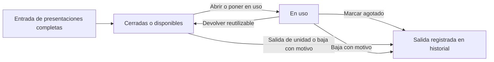
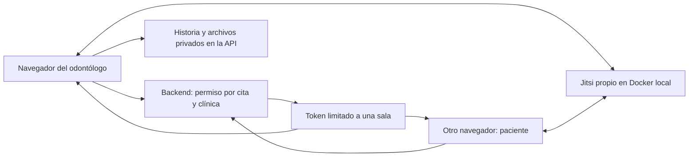

# CORONYX — plan de inventario y teleconsulta integrada

Fecha: 19/10/2026, America/Lima. Estado: análisis y planificación. No se modificaron funcionalidades, base de datos ni el Excel original en esta tarea.

**Revisión 2, acordada con el responsable:** el inventario se controla por presentación y estado desde el propio módulo, sin descuento ni registro obligatorio de consumo por cita. Esta revisión reemplaza la propuesta anterior de convertir cajas en piezas y confirmar materiales por atención. La teleconsulta integrada y su prueba local mantienen su alcance.

## 1. Decisiones del responsable

- Adaptar Inventario al funcionamiento de la empresa usando el Excel como referencia.
- Primera versión: **UNIDAD, CAJA y ENVASE** como presentaciones de control, sin fracciones de mililitros, gramos o metros.
- Registrar entradas, apertura/puesta en uso, agotamiento, salidas y ajustes directamente en Inventario. Distinguir existencias **cerradas/disponibles** y **en uso**; conservar agotamientos como historial.
- Las citas y la historia clínica no descuentan existencias ni exigen detallar materiales. No calcular consumo exacto ni costo de materiales por paciente con este alcance.
- La videollamada debe ocurrir **dentro de CORONYX**, permitiendo al odontólogo consultar y registrar historia clínica al mismo tiempo.
- **Alojamiento propio**. Primero probar todo **en una computadora**, sin contratar VPS, dominio ni proveedor de video en esta etapa.
- ML radiográfico, voz con IA y Superadministrador mantienen su exclusión. El audio normal de la videollamada sí pertenece a esta función.

Estas decisiones sustituyen la suposición anterior de dar por terminada la teleconsulta con un enlace externo. Los documentos y pruebas del 18/10 describen la implementación existente, no acreditan estas ampliaciones.

## 2. Qué contiene realmente el Excel

Fuente: `1 CONTADOR egreso e ingreso enero - diciem 2026 - copia (1).xlsx`, proporcionado por el responsable. SHA-256 de la copia inspeccionada: `fbf431adb70fb0529aecea20b5286f1fc7cbfbab3c785060a77fa09c3bedc725`.

Se inspeccionaron las **10 hojas**, todas visibles, y sus **23.317 celdas con contenido**, incluyendo fórmulas, resultados almacenados, filas/columnas ocultas y vínculos externos. No se recalculó el libro ni se abrieron sus dos archivos externos. El archivo original conservó su hash. Los datos personales y bancarios no se reproducen en este plan ni deben publicarse en GitHub.

Las imágenes incrustadas también se revisaron: cuatro archivos gráficos reutilizados en los formatos, correspondientes a logotipos y firmas con datos de identificación. No contienen un kardex adicional. No incorporar esas firmas a demostraciones, repositorios ni documentos públicos de prueba.

El nombre del archivo menciona ingresos/egresos mensuales. Su contenido es principalmente una combinación de **catálogo, directorios, seguimiento de clientes y formatos logísticos**. No permite reconstruir existencias mediante un kardex completo de entradas, salidas y saldo.

### Revisión de todas las hojas

1. **Proveedores:** directorio con RUC, razón social, dirección, teléfonos, contacto, correo, entrega y pago; también hay datos bancarios en algunas filas. Hay 120 filas con RUC y razón social informados, además de filas incompletas. Sirve para plantear un catálogo de proveedores; no representa stock ni acredita compras recibidas. La fórmula D6 consulta E4 en vez de la columna del indicador de su propia fila: revisar antes de reutilizar esa lógica.
2. **Cotizacion (14):** formato de cotización con un artículo. C10 busca en Proveedores, pero otros datos del destinatario se buscan en Clientes, produciendo cinco resultados `#N/A` almacenados en D10, G10, B12, D12 y G12. F10 contiene el texto de fecha imposible `30/30/2026`. Hay restos de catálogo muy por debajo del formato. No usarlo como recepción de mercadería.
3. **BIEN&SERVICIOS:** fuente principal para preparar productos/servicios. Encabezados en A3:D3: código, U.M., descripción y precio unitario. Mezcla consumibles odontológicos, instrumental reutilizable, equipos, limpieza, ferretería, tratamientos y otros servicios. No es una lista limpia de insumos consumibles.
4. **Clientes (2):** directorio con datos personales y columnas por mes/franjas de días. Estas columnas contienen textos de seguimiento, encabezados repetidos y notas; no forman un ledger de stock. Hay etiquetas y datos que requieren reconciliación, por ejemplo valores numéricos en B bajo «cumpleaños». No importar pacientes como efecto secundario de adaptar Inventario.
5. **S.Requerimiento:** solicitud de compra/servicio con solicitante, área, motivo, cantidades y descripción. Usa fórmulas ligadas a otro libro y otras con `#REF!` cubiertas por `IFERROR`. Una solicitud expresa una necesidad; no demuestra compra, recepción ni consumo.
6. **Cotizacion (12):** presupuesto de tratamientos, con cantidades, precio y notas de sesiones. Es relevante para un catálogo de servicios/presupuestos; sus cantidades no representan existencias físicas. Mantenerlo separado del costo de compra de materiales.
7. **ENTREGAN LA COTIZACIÓN:** solo se encontraron siete filas con restos de catálogo en las filas 1247–1258. No hay un registro completo de entregas de cotizaciones en esta copia. Conservar el origen sin inventar operaciones.
8. **Orden Compra:** formato con proveedor y cuatro líneas, cálculos de totales y referencias externas. A:B están ocultas e incluyen códigos de artículo. Los resultados almacenados muestran importes cero en líneas con cantidades; faltan precios utilizables. Una orden no debe aumentar automáticamente el almacén: falta confirmar recepción real.
9. **Orden Servicio:** contratación de servicios de laboratorio con cantidades e importes, fecha de 2025 y referencias externas. Sus productos/servicios no se consumen como guantes por cada cita. Hay fórmulas rotas cubiertas por valores vacíos y restos de catálogo al final.
10. **Orden Servicio (2):** otra orden, de capacitación, también fechada en 2025. Confirma que el libro incluye egresos/servicios ajenos al stock dental. No convertirlos en insumos consumibles.

### Calidad del catálogo que afecta a la adaptación

En `BIEN&SERVICIOS`, tomando como **candidatas** las filas desde la 4 con código y descripción:

- **1.162 filas candidatas**, con **1.122 códigos distintos**. No son 1.162 insumos listos para importar.
- **31 códigos repetidos**, que afectan a grupos de filas y generan 40 apariciones adicionales. Algunos códigos nombran variantes diferentes, como D2620 en las filas 631 y 637. No fusionar automáticamente por código ni conservar silenciosamente la primera coincidencia de un VLOOKUP.
- **347 filas candidatas sin unidad de medida**. Las presentes incluyen variantes de UNIDAD/UND, errores de escritura, CAJA, bolsa, paquete y metro.
- Solo **78 filas candidatas tienen un precio numérico positivo en D**; otras tres tienen fórmulas en D. También hay valores en E sin un encabezado suficiente para asumir que siempre son costo o precio con impuesto. No convertir precios faltantes en cero ni asumir que un precio de tratamiento es costo de material.
- Las descripciones sin código, títulos y textos de continuación requieren revisión. No generar insumos de encabezados como «ANESTESIA» o de frases partidas.
- Ejemplos: guantes en A86:C86 sin cantidad por caja; jeringas en A90:C91 mencionan caja, sin factor; eyector en A158:E158 dice bolsa de 100; silicona en A367:E367 usa caja y menciona 910 ml; alambre en A421:C421 usa metro; D9215 en A941:C941 combina una descripción de anestesia con U.M. CAJA y requiere aclaración de clasificación.

En todo el libro hay **304 fórmulas**. **67** hacen referencia a dos libros externos y **74** contienen el literal `#REF!`, muchas cubiertas por `IFERROR`. Hay cinco resultados de error `#N/A` almacenados. Los **87 resultados vacíos de fórmula son texto vacío guardado en XML**, no evidencia de 87 fórmulas sin calcular. Estos conteos se solapan y no deben sumarse como errores distintos. Los valores almacenados tampoco certifican que los enlaces externos estén actualizados.

**Conclusión sobre la importación:** aprovechar el catálogo después de clasificarlo y depurarlo. Para el stock inicial falta un conteo físico o un registro fiable de existencias. No derivarlo de cotizaciones, órdenes, filas de clientes ni de las cantidades de sesiones.

## 3. Inventario por presentación y estado

### Qué se cuenta

Cada SKU tiene una presentación de control: **UNIDAD**, **CAJA** o **ENVASE**. Se cuenta esa presentación completa. Una caja de guantes permanece como una caja; no se convierte automáticamente en cien guantes ni exige registrar cada par usado.

Conservar como información opcional el contenido indicado en el empaque, por ejemplo «100 guantes» o «frasco de 500 ml». Esa información no representa el contenido restante de una presentación abierta. Un cambio de capacidad o variante requiere un SKU/presentación diferenciados para no mezclar cajas de tamaños distintos.

El Excel también incluye bolsas, paquetes y metros. Conservar la descripción original y validar el mapeo con la clínica; no cambiar silenciosamente sus cantidades por unidades sueltas. Si un registro no encaja en las tres presentaciones, dejarlo pendiente de clasificación. No ampliar ni inventar conversiones para hacer pasar la importación.

### Cerrado/disponible, en uso y agotado

- **Cerrado/disponible:** cajas/envases sin abrir o unidades disponibles. Esta cantidad alimenta la alerta de reposición.
- **En uso:** cajas/envases abiertos o artículos puestos en uso. No exige conocer el porcentaje o número de piezas restantes.
- **Agotado:** salida histórica de una presentación que terminó. Ya no forma parte de las existencias actuales. No mantener «agotados» como un tercer saldo disponible ni borrar su movimiento.

El total físico actual es `cerrado/disponible + en uso`, siempre expresado en la presentación del SKU. No sumar cajas de un producto con unidades de otro. No hace falta identificar o numerar cada caja: para el MVP bastan cantidades por estado y movimientos auditables.

Ejemplo hipotético:

1. Recibir cinco cajas nuevas deja **5 cerradas, 0 en uso, total 5**.
2. Abrir una deja **4 cerradas, 1 en uso, total 5**. Abrir no descuenta el total.
3. Marcar esa caja como agotada deja **4 cerradas, 0 en uso, total 4**, con un agotamiento en el historial.

Una caja o botella a medio usar al comenzar se registra como **1 en uso, contenido restante desconocido**, sin inventar que queda exactamente la mitad. Un conteo inicial de cuatro cerradas y una abierta se carga con ese desglose y evidencia del conteo.

### Líquidos, unidades y reutilizables

El alcohol se controla por frasco/envase; el material dental puede controlarse por jeringa o recipiente; un rollo se registra como la presentación física acordada, sin medir metros utilizados. Abrir o usar unas gotas no agota el envase. Registrar su salida cuando se acabe o se descarte, desde Inventario.

Un artículo comprado por UNIDAD mantiene esa presentación. Si es consumible puede registrarse su salida manual. Si es reutilizable, usarlo no lo consume: una devolución a disponible puede cambiar su estado, mientras que daño/pérdida requiere una baja con motivo. No implementar un módulo nuevo de activos o esterilización en esta adaptación.

Clasificar como **consumible** o **reutilizable/equipo** antes de habilitar operaciones. Los servicios, tratamientos y gastos quedan fuera del stock consumible. No asignar consumo automático a ningún artículo por el hecho de atender una cita.

La alerta muestra el mínimo en la presentación elegida, las existencias cerradas/disponibles y las que están en uso. Una presentación abierta no debe hacer creer que existe otra completa de reserva. El sistema no conoce el remanente exacto ni el costo de materiales por paciente bajo este alcance.

## 4. Operación independiente de las citas

Todas las acciones se realizan dentro del **módulo Inventario existente**. No crear otro módulo ni añadir «Materiales utilizados» a la historia clínica para este MVP.

1. **Registrar entrada:** sumar presentaciones recibidas y confirmar si llegan cerradas/disponibles. Una cotización, orden o pago no genera la entrada por sí solo.
2. **Abrir/poner en uso:** trasladar una cantidad de cerradas/disponibles a en uso, sin alterar el total.
3. **Marcar agotado:** retirar de en uso una cantidad positiva de cajas/envases consumibles que terminaron, con autor y fecha. No permitir agotar más de lo que está en uso ni agotar un reutilizable por haberlo utilizado.
4. **Registrar salida o baja:** salida manual de una unidad consumible o retiro por daño, pérdida u otro motivo. Indicar el estado de origen y la razón; no confundir una baja con una devolución ni con un agotamiento normal.
5. **Devolver un reutilizable:** trasladarlo de en uso a disponible sin aumentar el total. Esta devolución no declara condiciones clínicas o de esterilización.
6. **Ajustar/corregir:** administrador con motivo obligatorio y movimiento de corrección que conserve el original. El conteo físico puede corregir el desglose por estado; no sobrescribir historial.

Cada acción valida clínica, rol, cantidad y estado en backend, bloquea el insumo y se aplica atómicamente. Un doble clic/reintento con la misma clave no repite la operación; reutilizar la clave con datos diferentes se rechaza. Concurrencia no puede producir cantidades negativas en ninguno de los dos estados aunque el total alcance.

Administración y recepción mantienen las operaciones ordinarias según sus permisos actuales; ajustes/correcciones quedan al administrador. El odontólogo no necesita nuevos permisos de inventario ni una pantalla de consumo en su atención. El paciente no consulta el módulo. Mantener el historial de movimientos separado del contenido clínico.

**Las citas no modifican stock:** reservar, iniciar, guardar, firmar, corregir, finalizar o cancelar una atención no crea salidas ni devoluciones. Una anulación de Caja tampoco devuelve material. La firma clínica conserva su contrato `versionId` + `revision` y no depende de una conciliación de materiales.

## 5. Brecha respecto del código actual y cambios previstos

El inventario existente en `InventoryItem`, `InventoryMovement`, `InventoryService`, `BusinessDtos`, `InventoryController` y `Inventario.tsx` ya proporciona saldo entero, movimientos, mínimos, bloqueo y protección de reintentos. Se conserva y se amplía.

Hoy hay un saldo único y una etiqueta libre de unidad, sin desglose cerrado/en uso ni operaciones de apertura/agotamiento. El servicio ya restringe Inventario a administración/recepción. No hace falta enlazarlo a `ClinicalAttentionService` para el alcance acordado. La teleconsulta actual abre Meet/Zoom en otra pestaña; esa brecha se trata en la sección 6.

### Modelo y API propuestos para Inventario

- Insumo: SKU interno por clínica, código original opcional no único por sí solo, nombre, categoría, presentación UNIDAD/CAJA/ENVASE, clasificación consumible/reutilizable, contenido descriptivo opcional, mínimo y estado. Conservar hoja/fila de importación y proveedor/costo cuando estén confirmados.
- Existencias: cantidades enteras cerradas/disponibles y en uso, ambas no negativas. Total derivado de su suma. Los agotamientos se obtienen del historial, sin incorporarse a existencias disponibles.
- Movimiento: operación, cantidad de presentaciones, estado de origen/destino, desglose anterior/resultante, motivo, autor, fecha y clave idempotente. Una corrección refiere el movimiento original. Conservar el significado de las ENTRADA/SALIDA/AJUSTE anteriores.
- Reutilizar la API autenticada de Inventario y añadir operaciones explícitas para abrir, agotar y devolver, junto con entradas, salidas y ajustes. No crear endpoints de consumo por atención ni tablas nuevas ligadas a citas para esta versión.
- Ajuste por estado: protegido por rol y revisión/bloqueo, sin permitir que un cliente envíe cantidades absolutas para saltarse movimientos. Los totales se calculan en backend, con protección de desbordamiento.
- Precio de compra, precio de venta y costo referencial no son intercambiables. El importador deja un precio sin clasificar como pendiente; no crea ceros ficticios ni cambia ceros históricos sin revisar su significado. El costo, si se registra, debe indicar la presentación a la que corresponde.
- Las migraciones se numeran tras revisar el historial real; no editar V1–V15 para introducir estas ampliaciones.

### Migración e importación previstas

Preparar una vista previa de mapeo del catálogo; identificar consumibles, reutilizables, servicios y registros pendientes. Resolver códigos duplicados y presentación con una persona de la clínica. Importar solo filas aprobadas, con registro de lote/archivo/hoja/fila y protección contra reimportación.

Preservar cantidades e historial existentes. Antes de migrar un saldo, verificar qué representa su etiqueta actual y cómo se distribuye entre disponible y en uso. Si falta esa información, dejarlo pendiente de validación, sin afirmar que todo está cerrado ni multiplicarlo por un contenido supuesto.

Cargar el catálogo no carga existencias. Registrar el conteo inicial por estado mediante movimientos auditables: por ejemplo, cuatro cajas cerradas y una en uso, no 450 piezas supuestas. No importar Clientes ni datos bancarios. Conservar el Excel original fuera de Git y no ejecutar sus fórmulas como instrucciones.

## 6. Teleconsulta integrada: recomendación para la prueba local

Recomiendo **Jitsi Meet alojado localmente con Docker**, integrado en la vista de atención mediante su API de integración. Es una propuesta técnica para el alcance elegido; todavía no está instalado/configurado ni probado en esta tarea. Docker está disponible como ejecutable en la computadora, pero no se comprobó el estado de su motor.

Jitsi ofrece integración en React/iframe y admite un dominio propio; eso permite mantener la llamada en un panel de CORONYX. Confirmar compatibilidad con React 19 antes de añadir el SDK; si hay un conflicto concreto, su API de iframe permite una integración controlada. Ver [React SDK](https://jitsi.github.io/handbook/docs/dev-guide/dev-guide-react-sdk/) y [IFrame API](https://jitsi.github.io/handbook/docs/dev-guide/dev-guide-iframe/).

La API de complementos de Google Meet documenta aplicaciones dentro de Meet. No demuestra que una sala ordinaria de Meet pueda incrustarse como llamada propia dentro de CORONYX. Por eso la integración actual de enlaces no basta para este requisito. Referencia: [Google Meet add-ons](https://developers.google.com/workspace/meet/add-ons/guides/overview).

LiveKit también permite integrar video con permisos por participante, pero desarrollar más controles propios añade trabajo al alcance de esta semana. Queda como alternativa si una prueba concreta demuestra que Jitsi no satisface la interfaz o el control de acceso. Esta comparación de esfuerzo es una evaluación del proyecto, no una medición de rendimiento. Referencia: [tokens y permisos de LiveKit](https://docs.livekit.io/frontends/reference/tokens-grants/).

### Vista de atención

En escritorio: panel de videollamada persistente y panel clínico con pestañas de resumen, historia/registro, odontograma y archivos. El componente de llamada permanece montado al cambiar de pestaña; no navegar a otra página que lo cierre. En pantalla pequeña, pestañas con la llamada en tamaño reducido y estado de conexión visible. Inventario sigue siendo un módulo independiente, sin una pestaña de consumo obligatoria en la atención.

El paciente entra desde su cita en el portal y ve la llamada, permisos de cámara/micrófono y material que ya tenga autorizado. El panel clínico del odontólogo no se envía al paciente ni se comparte como pantalla automáticamente.

«Colgar» termina la participación local; no firma la historia. «Terminar para todos» requiere al profesional autorizado y un cierre verificable de la sala. «Firmar atención» conserva el control clínico actual. La reconexión no duplica citas, versiones ni sesiones. Una caída de video no debe perder el borrador clínico.

### Backend y control de sala

- Crear una sesión de teleconsulta vinculada a una cita virtual de su clínica, con identificador opaco de sala, proveedor, estado y fechas. Mantener separados esos metadatos de los estados clínicos.
- El backend verifica paciente vinculado u odontólogo asignado antes de entregar un token de video. Un login válido de otra clínica u otra cita no basta.
- El token se genera exclusivamente en backend, sirve para la sala exacta y tiene duración limitada. No usar nombres de pacientes, documentos, diagnósticos ni JWT de sesión de CORONYX como nombres de sala o credencial del proveedor.
- Requiere autenticación en el servidor de video para **cada participante**: JWT, sin invitados anónimos y sin tokens vacíos. El Docker oficial documenta estos controles. No copiar ejemplos con acceso comodín a todas las salas. Ver [autenticación Docker](https://jitsi.github.io/handbook/docs/devops-guide/devops-guide-docker/#authentication).
- Probar que una URL directa al servidor de video y un token de otra sala también se rechazan. Ocultar el botón de entrada no basta.
- Validar quién puede moderar/cerrar la sala en la versión instalada; no asumir que un campo del token concede automáticamente ese control. Definir bloqueo de nuevos accesos al cancelar/cerrar y verificar expulsión/reingreso con tokens anteriores. La expiración por sí sola no prueba cierre de conexiones activas.
- No enviar historias por el canal de video. Los archivos siguen usando los endpoints privados del sistema. Sin grabación, transcripción automática o voz con IA en este MVP.

### Infraestructura local y límites de la demostración

Preparar un stack Jitsi independiente, con versión estable fijada y sus configuraciones en una carpeta de infraestructura del backend. Sus secretos/configuración local se excluyen de Git. No instalar otro Java sobre el Java 21 de la API; Docker mantiene aisladas las dependencias de video.

La primera validación puede hacerse en la misma computadora con dos perfiles o navegadores independientes y las cuentas ficticias de odontólogo/paciente. Comprobar disponibilidad de cámara para ambos contextos, usar auriculares y evitar realimentación de micrófonos. Esto prueba el flujo local; no acredita funcionamiento a través de Internet.

El ejemplo Docker oficial usa HTTPS local en 8443. Verificar certificado y permisos del navegador, y que el iframe tenga permiso de cámara/micrófono. Si se incorpora un segundo dispositivo por LAN, usar una dirección resoluble, certificado confiado en ambos dispositivos y la IP correcta anunciada por el servidor de medios. Un HTTP a una IP privada o una dirección `localhost` que apunta a cada dispositivo no demuestra conectividad correcta.

No instalar certificados de confianza, cambiar el router/firewall del sistema ni contratar/publicar infraestructura como parte de esta planificación. Al ejecutar después, concretar esos cambios según el entorno. Una llamada entre redes diferentes requiere verificar NAT/UDP y, cuando corresponda, TURN. Referencias: [Docker local y puertos](https://jitsi.github.io/handbook/docs/devops-guide/devops-guide-docker/) y [red/TLS del servidor](https://jitsi.github.io/handbook/docs/devops-guide/devops-guide-quickstart/).

## 7. Bloques de implementación y criterios de aceptación

Orden orientativo para una semana, condicionado a disponibilidad del entorno. El responsable pidió primero este plan: **no empezar a ejecutar estos bloques sin una petición posterior de implementación**. Conservar los cambios actuales de `feature/sebastian` en los dos repositorios y completar un bloque antes del siguiente.

1. **Inventario, contrato y datos (día 1):** confirmar una muestra con la clínica, presentación UNIDAD/CAJA/ENVASE, clasificación y conteo por estado. Preparar mapeo y migración aditiva sobre copia aislada. Aceptación: servicios y equipos no se consumen automáticamente, las cajas abiertas conservan remanente desconocido y no se inventa stock desde órdenes.
2. **Presentaciones y operaciones (día 2):** API y formularios de entrada, apertura, agotamiento, salida/baja, devolución y ajuste; mostrar cerrados/disponibles, en uso y mínimos. Aceptación: cinco cajas recibidas → cuatro cerradas y una en uso → cuatro cerradas tras agotar la abierta; apertura/devolución no cambia el total y un doble clic no duplica operaciones. El caso es ficticio, no dato del Excel.
3. **Importación y pruebas de Inventario (día 3):** vista previa del catálogo, clasificación de datos pendientes, conteo inicial e historial. Aceptación: reimportar no duplica; no hay cantidades negativas por estado ni pérdida de movimientos; el rol RECEPCIONISTA no realiza ajustes administrativos; iniciar/firmar/cancelar citas o anular cobros no cambia existencias. No crear integración de consumos con la historia clínica.
4. **Prueba técnica de Jitsi local (iniciar preparación antes, ejecutar días 3–4):** comprobar Docker/recursos, levantar stack aislado con JWT y probar dos participantes. Si el entorno falla, resolver el punto técnico antes de construir una interfaz que aparente conexión.
5. **Vista integrada (días 4–5):** llamada persistente, historial/registro/archivos y portal del paciente, con manejo de dispositivos, caída/reconexión y fin de llamada. Aceptación: consultar y guardar historia mientras se ve/oye al paciente sin desmontar la llamada; el paciente nunca recibe el panel clínico.
6. **Regresión y evidencia (día 5 y margen disponible):** casos nuevos más las pruebas existentes y recorridos por rol. Registrar qué se verificó en dos contextos de una misma computadora y qué queda pendiente para LAN/Internet. No convertir una demostración local en certificación de producción.

### Casos adicionales imprescindibles

- Importación: código duplicado con descripciones distintas; presentación vacía o sin mapeo; precio desconocido; referencias externas; reimportación sin duplicados; catálogo sin stock inicial; conteo inicial con cajas/envases abiertos sin estimar su contenido.
- Inventario: apertura conserva total; agotamiento reduce solo en uso; rechazo si no hay presentaciones en el estado de origen; salida de unidad; baja con motivo; devolución de reutilizable sin aumentar total; agotamiento de reutilizable rechazado; mínimo basado en cerrados/disponibles mostrando en uso por separado.
- Integridad y permisos: clínica ajena rechazada; recepción sin ajustes administrativos; paciente sin acceso; dos operaciones simultáneas sobre la última caja; reintento idéntico frente a clave reutilizada con datos distintos; corrección con motivo sin borrar el original; cantidades negativas, cero no permitido y desbordamiento.
- Independencia clínica: reservar/iniciar/guardar/firmar/corregir/finalizar/cancelar una cita o anular un cobro no modifica stock ni exige capturar materiales. La falta de stock nunca bloquea la firma clínica.
- Teleconsulta: dos usuarios reales de prueba, permisos denegados de cámara, micrófono silenciado, conexión perdida, recarga con borrador guardado, historia sin cortar video, paciente ajeno, acceso directo sin token, token de otra sala y sala finalizada que no se reabre por reintento.

Los 91 tests backend y 10 frontend registrados el 18/10 son la base histórica, no validan las funciones nuevas. Al implementar, repetir pruebas relevantes, tipos/build y la suite backend con PostgreSQL aislado; añadir pruebas de las reglas anteriores y revisión real en navegador con el servidor de video propio.

## 8. Requisitos y documentación que cambian

Registrar como ampliaciones pendientes, con evidencia al implementarlas:

- INV-01: control por presentación UNIDAD/CAJA/ENVASE, sin conversión obligatoria a piezas.
- INV-02: clasificación consumible/reutilizable y separación de servicios respecto de existencias.
- INV-03: apertura/puesta en uso y agotamiento manuales, con cantidades por estado, confirmación única e historial auditable dentro de Inventario.
- INV-04: importación controlada del catálogo, sin inferir stock.
- INV-05: Inventario independiente de citas, firma clínica y cobros; las acciones clínicas no descuentan ni devuelven existencias.
- TEL-01: videollamada dentro del sistema y vista clínica simultánea.
- TEL-02: video alojado por el equipo, primero local, con acceso por cita y participantes autorizados.
- TEL-03: persistencia del registro clínico y reconexión independiente del estado de la llamada.

Actualizar el anexo de requisitos, la guía de Antigravity, casos de aceptación y contratos API cuando se implemente cada bloque. Los PDF ya presentados se conservan. Caja, Inventario y teleconsulta no deben declararse completos con los criterios antiguos después de ampliar estos requisitos.

La revisión 2 sustituye los requisitos anteriores de factor obligatorio de conversión y consumo confirmado por atención. Esos requisitos eran propuestas pendientes, no funciones acreditadas. No implementarlos por arrastre de un prompt o versión anterior.

Fuera de esta primera adaptación: conteo obligatorio de piezas dentro de cajas, medición por ml/g/metro, consumo/costo de materiales por cita, plantillas de consumo clínico, lotes y vencimientos como módulo completo, compras/contabilidad integral, grabación de llamadas, producción pública, ML, voz con IA y Superadministrador. Conservar los datos originales de lotes o presentación que existan en descripciones sin afirmar que constituyen un control operativo de vencimientos.
