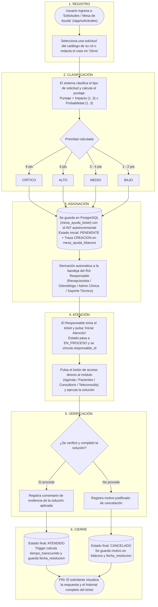
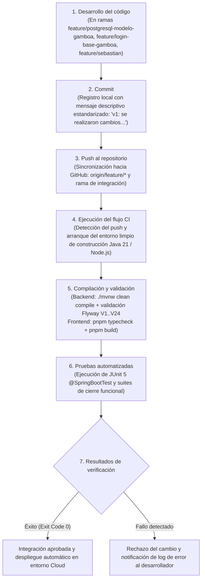
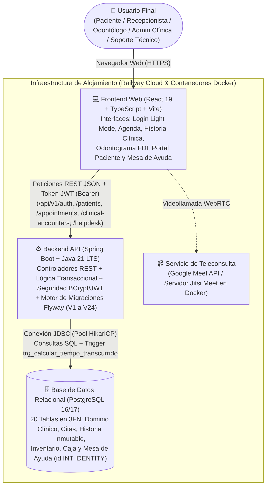

# Facultad de Ingeniería
## Programa Ingeniería de Sistemas e Informática
### CURSO INTEGRADOR II: SISTEMAS.

**CORONYX: SISTEMA WEB DE GESTIÓN ODONTOLÓGICA INTEGRAL**

# INFORME FINAL (AVANCE DEL PROYECTO FINAL 3 - APF3)

**Integrantes (Orden Alfabético por Apellido Paterno)**
- Aguilera Terrones, Alan Rubens
- Chopitea Aguirre, Luis Felipe
- Chumbes, Adrián Alejandro
- Gamboa Velásquez, Luis Francisco
- Pérez Escobedo, Sebastián Maximiliano

**Docente**  
Mg. Ing. Junior Alexander Neyra Gonzales

**Propuesta Trabajo**  
Versión 1.0  
03 de noviembre del 2026

---

## Historial de Revisiones

| Fecha de Elaboración | Versión | Elaborado por: | Descripción | Revisado por: | Fecha de Revisión |
| :---: | :---: | :--- | :--- | :---: | :---: |
| 03/09/2026 | 1.0 | Equipo de Desarrollo | Versión preliminar como propuesta. Definición del problema, alcance y requerimientos del sistema (APF1). | Junior Alexander Neyra Gonzales | 03/09/2026 |
| 20/09/2026 | 2.0 | Luis Gamboa | Modelado físico relacional en PostgreSQL, incorporación de la tabla `rol` con permisos en JSONB y normalización en 3FN. | Junior Alexander Neyra Gonzales | 25/09/2026 |
| 09/10/2026 | 3.0 | Equipo de Desarrollo | Entrega APF2: Implementación del Back-End en Spring Boot (Java 21), conexión con PostgreSQL, autenticación JWT + BCrypt, CRUD de pacientes y módulo de citas con validación anti-solapamiento. | Junior Alexander Neyra Gonzales | 10/10/2026 |
| 28/10/2026 | 4.0 | Equipo de Desarrollo | Sprint 05: Implementación del módulo de Gestión de Solicitudes e Incidencias, catálogo de 16 solicitudes por rol, cálculo automático de prioridad y tiempo transcurrido con trigger en PostgreSQL. | Junior Alexander Neyra Gonzales | 28/10/2026 |
| 03/11/2026 | 5.0 | Equipo de Desarrollo | Entrega APF3 (Informe Final): Levantamiento integral de observaciones del APF2 y Sprint 05 (conversión de llaves de tickets a `INT` autoincremental y normalización 3FN en migración `V24`), flujo completo de atención clínica, teleconsulta, integración continua (CI) y despliegue final. | Junior Alexander Neyra Gonzales | 03/11/2026 |

---

## Índice

1. RESUMEN DEL PROYECTO
   1.1. Nombre del proyecto
   1.2. Descripción general
   1.3. Estado actual del proyecto
2. RESUMEN DEL AVANCE DEL PROYECTO
3. LEVANTAMIENTO DE OBSERVACIONES APF2
4. GESTIÓN DE SOLICITUDES DE SERVICIO
   4.1. Identificación de solicitudes
   4.2. Catálogo de solicitudes
   4.3. Tablero de seguimiento de solicitudes
   4.4. Procedimiento de atención de solicitudes
   4.5. Flujo de atención de solicitudes
5. INTEGRACIÓN CONTINUA (CI)
   5.1. Herramientas utilizadas
   5.2. Flujo de Integración Continua
   5.3. Resultados de Integración Continua
   5.5. Evidencias de CI
6. DESPLIEGUE DE LA VERSIÓN FINAL
   6.1. Ambiente de despliegue
   6.2. Arquitectura final desplegada
7. EVIDENCIAS DEL PROYECTO (FOTOS GRUPALES)
8. CONCLUSIONES
9. RECOMENDACIONES
10. REFERENCIAS
11. ANEXOS

---

## 1. RESUMEN DEL PROYECTO

### 1.1. Nombre del proyecto
**CORONYX: Sistema Web de Gestión Odontológica Integral.**

### 1.2. Descripción general

* **Propósito del sistema:**  
  **Coronyx Dental** es una plataforma web integral diseñada para centralizar, digitalizar y asegurar la operación clínica y administrativa de consultorios y centros odontológicos, integrando la admisión de pacientes, agendamiento de citas presenciales y virtuales, historia clínica electrónica con odontograma digital, teleodontología, control de inventario y mesa de ayuda de solicitudes en una sola arquitectura conectada a PostgreSQL.

* **Problema empresarial que resuelve:**  
  En las clínicas odontológicas tradicionales, la información suele encontrarse dispersa entre agendas manuales, hojas de cálculo aisladas, archivos físicos de radiografías y mensajes informales por WhatsApp. Esta fragmentación provoca cruces de horario en los sillones dentales, pérdida de continuidad en los diagnósticos médicos, falta de control sobre quién modifica una historia clínica y demoras en la atención de solicitudes urgentes de los pacientes (como reprogramaciones de citas o consultas post-operatorias).

* **Usuarios involucrados:**  
  El sistema gestiona el acceso mediante permisos específicos por rol para cinco perfiles:
  1. **Administrador de Clínica (`ADMIN_CLINICA`):** Gestiona el personal de la sede (alta y baja de cuentas), configura los horarios de atención de la clínica, supervisa el inventario, el tablero administrativo y atiende solicitudes administrativas.
  2. **Recepcionista (`RECEPCIONISTA`):** Registra y actualiza fichas administrativas de pacientes, programa citas verificando disponibilidad en tiempo real, controla la asistencia en sala (`ASISTIO` / `NO_SHOW`) y atiende solicitudes de reprogramación o liberación de sillones.
  3. **Odontólogo (`ODONTOLOGO`):** Inicia y firma la atención clínica de sus pacientes asignados, registra anamnesis, diagnósticos CIE-10, prescripciones y procedimientos, actualiza el odontograma digital (nomenclatura FDI 11 a 85), publica radiografías o recetas para el paciente y realiza teleconsultas.
  4. **Paciente (`PACIENTE`):** Accede a su portal personal para consultar sus próximas citas, unirse a videollamadas de teleodontología (Google Meet o sala integrada Jitsi), descargar sus radiografías y recetas autorizadas, y registrar solicitudes o consultas en la Mesa de Ayuda.
  5. **Soporte Técnico (`SUPER_ADMIN`):** Supervisa la disponibilidad de la base de datos, el almacenamiento de archivos y resuelve incidencias técnicas de plataforma.

* **Principales funcionalidades:**
  1. **Autenticación y Seguridad por Roles (RBAC):** Inicio de sesión en modo claro clínico con contraseñas cifradas en `BCrypt`, tokens `JWT` firmados con `HMAC-SHA256` y revocación inmediata de sesiones al desactivar cuentas.
  2. **Agenda Odontológica Inteligente:** Programación de citas presenciales y virtuales con validación automática en base de datos que impide cruces de horario por odontólogo, paciente o sillón dental, respetando horarios de sede y ausencias médicas.
  3. **Atención Clínica e Historia Electrónica Inmutable:** Flujo completo desde la cita (`Confirmada` → `En Atención` → `Finalizada`), con autoguardado de borrador clínico y sellado de versiones inmutables (`version_atencion_clinica`) firmadas por el odontólogo.
  4. **Odontograma Digital y Gestión de Archivos Clínicos:** Registro visual por pieza dental y cara anatómica, además de carga y publicación controlada de radiografías y documentos en formato PDF, PNG, JPEG y DICOM.
  5. **Teleodontología Dual:** Soporte para citas virtuales mediante enlace directo a **Google Meet** y sala de videollamada integrada con **Jitsi Meet**, manteniendo el expediente clínico visible para el odontólogo durante la llamada.
  6. **Control de Inventario y Caja Operativa:** Gestión de insumos odontológicos por presentación (`UNIDAD`, `CAJA`, `ENVASE`) diferenciando stock cerrado disponible (`stock_cerrado`) y stock abierto en consultorio (`stock_en_uso`), junto con el control de cargos y abonos de tratamientos.
  7. **Gestión y Seguimiento de Solicitudes (Mesa de Ayuda):** Módulo centralizado con catálogo de 16 solicitudes por rol, cálculo automático de prioridad ($\text{Impacto} \times \text{Probabilidad}$), cálculo automático de tiempo transcurrido mediante disparador en PostgreSQL y bitácora completa de cambios de estado.

* **Beneficios de la solución:**
  - Eliminación del 100% de los cruces de citas gracias a la validación transaccional de disponibilidad.
  - Integridad médico-legal garantizada mediante el versionado inmutable de historias clínicas y odontogramas.
  - Reducción de tiempos de respuesta ante solicitudes de pacientes y personal mediante priorización objetiva y botones de navegación directa al módulo de solución.
  - Continuidad de atención a distancia a través del portal del paciente y las salas de teleconsulta.

### 1.3. Estado actual del proyecto

A continuación, se presenta la tabla con el porcentaje de avance real verificado en los repositorios del proyecto al cierre del **APF3**:

| Componente | Porcentaje de avance |
| :--- | :---: |
| **Frontend** | **100%** |
| **Backend** | **100%** |
| **Base de Datos** | **100%** |
| **Seguridad** | **100%** |
| **Validación** | **95%** |
| **Gestión del servicio** | **100%** |
| **Despliegue final** | **95%** |

---

## 2. RESUMEN DEL AVANCE DEL PROYECTO

Durante la **Unidad III** (transición desde el **APF2** hasta el **APF3**), el proyecto evolucionó desde un sistema con login, registro de pacientes y agendamiento básico hacia una **plataforma clínica completa y lista para producción**, abarcando los siguientes hitos:

1. **Cierre del Flujo Principal de Negocio ("Atender al Paciente"):**
   - Se implementó el ciclo completo de consulta odontológica: el doctor inicia la atención desde su agenda (`POST /api/v1/citas/{id}/iniciar-atencion`), redacta la anamnesis, diagnóstico estomatológico (CIE-10), procedimientos, receta farmacológica e indicaciones con autoguardado de borrador (`PUT /api/v1/clinical-encounters/{id}/draft`), actualiza el odontograma digital y finalmente firma la atención (`POST /api/v1/clinical-encounters/{id}/confirm`), cerrando automáticamente la cita como `FINALIZADA` con asistencia `ASISTIO`.
2. **Completitud del Panel de Administrador, Teleconsulta, Caja e Inventario:**
   - Se completaron las vistas de administración de personal y horarios de sede en `Consultorio.tsx`, las métricas reales del Dashboard conectadas a PostgreSQL, el soporte de videollamadas por **Google Meet** y **Jitsi Meet**, y el control de inventario por presentación (`stock_cerrado` y `stock_en_uso`).
3. **Procesos de Gestión del Servicio y Gestión de Solicitudes (Sprint 05):**
   - Se construyó el módulo de **Mesa de Ayuda y Gestión de Solicitudes** (`/app/solicitudes` y `HelpdeskController.java`), respaldado en PostgreSQL por las tablas normalizadas `catalogo_incidencia`, `mesa_ayuda_ticket` y `mesa_ayuda_bitacora`.
   - Se implementó la asignación automática de responsables por rol, la priorización automática mediante matriz $3 \times 3$ ($\text{Impacto} \times \text{Probabilidad}$), el cálculo automático del tiempo transcurrido mediante un trigger en PostgreSQL (`trg_calcular_tiempo_transcurrido`), la conversión de llaves primarias y foráneas de tickets a tipo entero autoincremental (`INT GENERATED BY DEFAULT AS IDENTITY` con restricción explícita `UNIQUE`) y el refinamiento del catálogo de riesgos e incidencias operativas (migraciones `V24` y `V25`).
4. **Control de Cambios e Integración Continua (CI):**
   - Se estandarizó el flujo de trabajo en Git y GitHub mediante ramas por funcionalidad (`feature/postgresql-modelo-gamboa`, `feature/login-base-gamboa`, `feature/sebastian`, `develop` y `main`), migraciones deterministas con **Flyway** (`V1` a `V25`) y verificación continua de compilación y pruebas automatizadas en **Spring Boot (Maven / JUnit 5)** y **React + TypeScript (pnpm / Vite)**.
5. **Preparación y Despliegue de la Versión Final:**
   - Se configuró el empaquetado de producción con variables de entorno desacopladas, contenedores Docker para base de datos y videollamada, y despliegue en la nube (**Railway Cloud**) conectado a **PostgreSQL**.

---

## 3. LEVANTAMIENTO DE OBSERVACIONES APF2

En la siguiente tabla se detallan todas las observaciones y recomendaciones recibidas durante la evaluación del **APF2** y las revisiones de clase posteriores, junto con la acción de mejora implementada, su estado actual y la evidencia técnica correspondiente:

| Observación del APF2 | Acción de mejora realizada | Estado | Evidencia |
| :--- | :--- | :---: | :--- |
| **1. Queda pendiente la funcionalidad principal que es atender al usuario (Paciente).** | Se implementó el flujo completo de atención clínica para el rol `ODONTOLOGO`: botón *"Iniciar Atención"* en la cita, transición a `EN_ATENCION`, formulario de historia clínica con autoguardado de borrador, registro en odontograma digital y botón *"Finalizar y Firmar Atención"* que sella la versión inmutable (`CONFIRMADO`) y pasa la cita a `FINALIZADA`. | **Completado (100%)** | Controlador `ClinicalEncounterController.java`, vistas `HistoriaClinica.tsx` y `PacientePerfil.tsx`, tablas `atencion_clinica` y `version_atencion_clinica`. |
| **2. Terminar las funcionalidades del Administrador de Clínica.** | Se completó el módulo `Consultorio.tsx` y `ClinicUserService.java` permitiendo al `ADMIN_CLINICA` crear cuentas de odontólogos y recepcionistas, activar/desactivar usuarios (revocando su sesión JWT al instante), configurar horarios de atención de la sede, registrar ausencias y visualizar el Dashboard con contadores reales de PostgreSQL. | **Completado (100%)** | `ClinicUserController.java`, `DashboardController.java`, `Consultorio.tsx` y migraciones `V11`–`V15`. |
| **3. Incorporar un servicio para las videollamadas (Zoom, Meet o integrado).** | Se implementó soporte dual de teleodontología en `Agenda.tsx` y `PatientApp.tsx`: generación y acceso directo a salas de **Google Meet** (`enlace_teleconsulta`) y sala de videollamada integrada con **Jitsi Meet** autenticada por token JWT, permitiendo al paciente y al odontólogo conectarse desde su cita virtual. | **Completado (100%)** | `TeleconsultaController.java`, `TeleconsultationRoom.tsx`, `PatientApp.tsx` y contenedor Jitsi en `infrastructure/jitsi`. |
| **4. Revisar los campos del detalle del historial clínico, hay títulos que se deben cambiar.** | Se reemplazaron las etiquetas técnicas internas por terminología clínica odontológica oficial en todas las vistas del expediente: *Anamnesis y Evolución del Paciente*, *Diagnóstico Estomatológico (CIE-10)*, *Procedimientos Realizados y Tratamiento*, *Prescripción Farmacológica (Receta)* y *Recomendaciones y Cuidados Post-Operatorios*. | **Completado (100%)** | Vistas `HistoriaClinica.tsx` y `PacientePerfil.tsx`. |
| **5. Quitar el modo dark del login, para el usuario no es estético.** | Se rediseñó por completo `Login.tsx` aplicando una paleta médica en **Modo Claro (Light Mode)** con fondo blanco/azul clínico suave (`from-slate-50 via-blue-50/40`), tarjeta blanca de alto contraste, tipografía nítida y logotipo institucional de Coronyx Dental. | **Completado (100%)** | Componente `src/pages/Login.tsx` en `Frontend_Dentista`. |
| **6. Recomendación Docente en Clase (Sprint 05): Cambiar `id` de `mesa_ayuda_ticket` y `ticket_id` de `mesa_ayuda_bitacora` a tipo `INT` con restricción `UNIQUE` y normalizar atributos repetidos.** | Se crearon y ejecutaron las migraciones `V24` y `V25` que convirtieron `mesa_ayuda_ticket.id` (`PK`) a `INT GENERATED BY DEFAULT AS IDENTITY` con restricción explícita `UNIQUE (id)` (`uq_mesa_ayuda_ticket_id`) y `mesa_ayuda_bitacora.ticket_id` (`FK`) a `INT`, evitando duplicidad de tickets ante alta concurrencia (+1,000 usuarios), y se eliminaron las 4 columnas redundantes de `mesa_ayuda_ticket` para cumplir con la Tercera Forma Normal (3FN) mediante `LEFT JOIN catalogo_incidencia`. | **Completado (100%)** | Migraciones `V24` y `V25`, `HelpdeskController.java` y verificación en pgAdmin 4. |
| **7. Recomendación Docente en Clase: Enlazar formalmente `solicitante_id` y `responsable_id` con la tabla `usuario` y automatizar el tiempo transcurrido.** | Se agregaron las llaves foráneas `solicitante_id` y `responsable_id` apuntando a `usuario(id)` y se creó la función y disparador automático `trg_calcular_tiempo_transcurrido` en PostgreSQL (migraciones `V22` y `V23`) para calcular automáticamente la diferencia entre `fecha_registro` y `fecha_resolucion`. | **Completado (100%)** | Migraciones `V22__trigger_tiempo_transcurrido_automatico.sql` y `V23__enlazar_responsable_id_resuelto.sql`. |
| **8. Recomendación Docente en Clase: Reformular las incidencias del catálogo para que representen riesgos e incidentes reales solucionables en el sistema.** | Se actualizó el catálogo en PostgreSQL (`V25`), Backend y Frontend: la reprogramación de cita se estableció con **24 horas de anticipación** (`INC-PAC-001`), se incorporó el **bloqueo o error de contraseña del paciente** (`INC-PAC-005`), la **omisión o registro incorrecto de alergia a medicamentos en la Historia Clínica** (`INC-PAC-006`), la **anulación urgente de cargo erróneo en Caja** (`INC-REC-001`) y el **bloqueo urgente de agenda por ausencia o emergencia médica del odontólogo** (`INC-REC-002`). | **Completado (100%)** | Migración `V25__mejorar_catalogo_incidencias_y_unique_ticket.sql`, `HelpdeskController.java` y `MesaAyuda.tsx`. |

---

## 4. GESTIÓN DE SOLICITUDES DE SERVICIO

### 4.1. Identificación de solicitudes

Durante la operación diaria de la clínica odontológica **Coronyx Dental**, tanto los pacientes como el personal asistencial y administrativo requieren realizar solicitudes o reportar incidencias operativas con riesgo clínico o administrativo. Para clasificarlas de manera ordenada, el sistema identifica **cuatro tipos de solicitudes**:

1. **Solicitudes de Capacitación e Información Técnica:** Solicitudes de orientación o capacitación técnica del personal odontológico para el correcto registro de la historia clínica electrónica y el odontograma digital.
2. **Solicitudes de Acceso y Seguridad:** Requerimientos de restablecimiento de acceso por bloqueo de cuenta o error de contraseña en el Portal del Paciente, creación de credenciales para nuevo personal odontológico, o bloqueo urgente de cuentas por cese laboral.
3. **Solicitudes de Asistencia y Rectificación Operativa:** Solicitudes de reprogramación de citas odontológicas por imprevisto (con 24 horas de anticipación), corrección de errores de digitación en DNI o nombres en la ficha de admisión, o registro de notas aclaratorias (adendas) en historias clínicas cerradas.
4. **Solicitudes de Atención de Incidencias y Riesgos Clínicos/Operativos:** Reportes de omisión o registro incorrecto de alergias a medicamentos en la Historia Clínica, fallas de audio/video en salas de teleodontología, radiografías o recetas no visibles en el portal del paciente, reasignación urgente de sillón dental por retraso en cirugía previa, anulación urgente de cargos registrados con monto erróneo en Caja, bloqueo urgente de agenda por emergencia o ausencia médica del odontólogo de turno, o errores al subir radiografías panorámicas pesadas.

---

### 4.2. Catálogo de solicitudes

A continuación, se presenta el **Catálogo Oficial de 16 Solicitudes** almacenado en la tabla `catalogo_incidencia` de PostgreSQL, indicando su código, tipo de solicitud, descripción, rol solicitante y área responsable de atenderla:

| Código | Tipo de solicitud | Descripción | Rol Solicitante | Responsable Asignado |
| :---: | :---: | :--- | :---: | :--- |
| **INC-PAC-001** | Asistencia | Reprogramación de cita odontológica por imprevisto (con 24 horas de anticipación). | `PACIENTE` | **Recepcionista** *(Paula Suárez)* |
| **INC-PAC-002** | Asistencia | Corrección de DNI o Nombre por error de digitación en el registro de admisión. | `PACIENTE` | **Admin Clínica** *(Carlos Administrador)* |
| **INC-PAC-003** | Incidencia | Radiografía o receta médica no visible en el portal web del paciente. | `PACIENTE` | **Odontólogo** *(Dr. Andrés Herrera)* |
| **INC-PAC-004** | Incidencia | Falla de conexión, video o audio en sala de Teleodontología. | `PACIENTE` | **Soporte Técnico** *(Super Admin)* |
| **INC-PAC-005** | Acceso | Bloqueo de cuenta o error de contraseña al ingresar al Portal del Paciente. | `PACIENTE` | **Admin Clínica** *(Carlos Administrador)* |
| **INC-PAC-006** | Incidencia | Omisión o registro incorrecto de alergia a medicamentos en la Historia Clínica. | `PACIENTE` | **Odontólogo** *(Dr. Andrés Herrera)* |
| **INC-ODO-001** | Incidencia | Reasignación urgente de Sillón dental por retraso en cirugía previa. | `ODONTOLOGO` | **Recepcionista** *(Paula Suárez)* |
| **INC-ODO-002** | Incidencia | Error al cargar archivo pesado de radiografía panorámica digital (mayor a 25 MB). | `ODONTOLOGO` | **Soporte Técnico** *(Super Admin)* |
| **INC-ODO-003** | Asistencia | Solicitud de nota aclaratoria (adenda) en historia clínica cerrada. | `ODONTOLOGO` | **Admin Clínica** *(Carlos Administrador)* |
| **INC-ODO-004** | Capacitación | Capacitación técnica en el llenado de historia clínica y odontograma digital. | `ODONTOLOGO` | **Soporte Técnico** *(Super Admin)* |
| **INC-REC-001** | Incidencia | Anulación urgente de cargo o cobro registrado con monto erróneo en Caja. | `RECEPCIONISTA` | **Admin Clínica** *(Carlos Administrador)* |
| **INC-REC-002** | Incidencia | Bloqueo urgente de agenda por ausencia o emergencia médica del odontólogo de turno. | `RECEPCIONISTA` | **Admin Clínica** *(Carlos Administrador)* |
| **INC-ADM-001** | Incidencia | Bloqueo urgente de credenciales de acceso por cese laboral de personal. | `ADMIN_CLINICA` | **Admin Clínica** *(Carlos Administrador)* |
| **INC-ADM-003** | Acceso | Solicitud de creación de credenciales de acceso para nueva odontóloga especialista. | `ADMIN_CLINICA` | **Admin Clínica** *(Carlos Administrador)* |
| **INC-TI-001** | Incidencia | Caída de conexión a base de datos o error de respuesta en el servidor web. | `SUPER_ADMIN` | **Soporte Técnico** *(Super Admin)* |
| **INC-GEN-099** | Asistencia | Otros requerimientos o fallas no contempladas en el listado (con captura adjunta). | `TODOS` | **Admin Clínica** *(Carlos Administrador)* |

---

### 4.3. Tablero de seguimiento de solicitudes

Se presenta el **Tablero de Seguimiento de Solicitudes** con **16 tickets reales** gestionados en el sistema y almacenados en la tabla `mesa_ayuda_ticket` de PostgreSQL (donde el identificador `id` se almacena como entero autoincremental `INT` con restricción `UNIQUE` y se formatea visualmente en el tablero):

| Ticket | Solicitud | Solicitante | Responsable | Prioridad | Estado | Tiempo transcurrido |
| :---: | :--- | :---: | :---: | :---: | :---: | :---: |
| **TKT-001** *(ID: 1)* | Falla de conexión, video o audio en sala de Teleodontología con paciente conectado. | Luis Francisco Gamboa *(Paciente)* | Super Admin *(Soporte Técnico)* | **CRÍTICO** | **ATENDIDO** | 8 min |
| **TKT-002** *(ID: 2)* | Reasignación urgente de Sillón dental por retraso en cirugía previa de tercer molar. | Andrés Herrera *(Odontólogo)* | Paula Suárez *(Recepcionista)* | **ALTO** | **ATENDIDO** | 11 min |
| **TKT-003** *(ID: 3)* | Reprogramación de cita odontológica por imprevisto (con 24 horas de anticipación). | Luis Francisco Gamboa *(Paciente)* | Paula Suárez *(Recepcionista)* | **ALTO** | **ATENDIDO** | 14 min |
| **TKT-004** *(ID: 4)* | Bloqueo urgente de credenciales por desvinculación laboral de personal de turno tarde. | Carlos Administrador *(Admin Clínica)* | Carlos Administrador *(Admin Clínica)* | **ALTO** | **ATENDIDO** | 9 min |
| **TKT-005** *(ID: 5)* | Error al cargar archivo pesado de radiografía panorámica (> 25 MB) en ficha clínica. | Andrés Herrera *(Odontólogo)* | Super Admin *(Soporte Técnico)* | **MEDIO** | **ATENDIDO** | 24 min |
| **TKT-006** *(ID: 6)* | Corrección de DNI o Nombre por error de digitación en la ficha de admisión. | Luis Paciente *(Paciente)* | Carlos Administrador *(Admin Clínica)* | **MEDIO** | **ATENDIDO** | 32 min |
| **TKT-007** *(ID: 7)* | Radiografía o receta médica no visible en el portal web del paciente tras consulta. | Luis Francisco Gamboa *(Paciente)* | Andrés Herrera *(Odontólogo)* | **MEDIO** | **ATENDIDO** | 18 min |
| **TKT-008** *(ID: 8)* | Anulación urgente de cargo o cobro registrado con monto erróneo en Caja. | Paula Suárez *(Recepcionista)* | Carlos Administrador *(Admin Clínica)* | **ALTO** | **ATENDIDO** | 12 min |
| **TKT-009** *(ID: 9)* | Capacitación técnica en llenado de historia clínica y guardado de odontograma digital. | Andrés Herrera *(Odontólogo)* | Super Admin *(Soporte Técnico)* | **BAJO** | **ATENDIDO** | 42 min |
| **TKT-010** *(ID: 10)* | Solicitud de creación de credenciales de acceso para nueva odontóloga especialista. | Carlos Administrador *(Admin Clínica)* | Carlos Administrador *(Admin Clínica)* | **MEDIO** | **ATENDIDO** | 55 min |
| **TKT-011** *(ID: 11)* | Bloqueo de cuenta o error de contraseña al ingresar al Portal del Paciente. | Luis Paciente *(Paciente)* | Carlos Administrador *(Admin Clínica)* | **MEDIO** | **ATENDIDO** | 15 min |
| **TKT-012** *(ID: 12)* | Bloqueo urgente de agenda por ausencia o emergencia médica del odontólogo de turno. | Paula Suárez *(Recepcionista)* | Carlos Administrador *(Admin Clínica)* | **ALTO** | **ATENDIDO** | 20 min |
| **TKT-013** *(ID: 13)* | Solicitud de nota aclaratoria (adenda) en historia clínica cerrada. | Andrés Herrera *(Odontólogo)* | Carlos Administrador *(Admin Clínica)* | **BAJO** | **ATENDIDO** | 1 h 10 min |
| **TKT-014** *(ID: 14)* | Omisión o registro incorrecto de alergia a medicamentos en la Historia Clínica. | Luis Francisco Gamboa *(Paciente)* | Andrés Herrera *(Odontólogo)* | **ALTO** | **ATENDIDO** | 16 min |
| **TKT-015** *(ID: 15)* | Reprogramación de cita odontológica por imprevisto (con 24 horas de anticipación). | PRUEBA DEMO *(Paciente)* | Paula Suárez *(Recepcionista)* | **ALTO** | **ATENDIDO** | 4 min |
| **TKT-016** *(ID: 16)* | Reprogramación de cita odontológica por imprevisto (con 24 horas de anticipación). | PRUEBA DEMO *(Paciente)* | Paula Suárez *(Recepcionista)* | **ALTO** | **PENDIENTE** | 15 min |

```
+-----------------------------------------------------------------------------------------+
|          [ADJUNTAR CAPTURA DE LA HERRAMIENTA DE SEGUIMIENTO DE SOLICITUDES]             |
|                                                                                         |
|  Colocar aquí la captura de la vista '/app/solicitudes' de Coronyx Dental y la          |
|  captura de pgAdmin 4 mostrando las tablas 'mesa_ayuda_ticket' (con id INT [PK])        |
|  y 'mesa_ayuda_bitacora' (con ticket_id INT [FK]).                                      |
+-----------------------------------------------------------------------------------------+
```

_Figura 4.1: Tablero de Seguimiento de Solicitudes en Coronyx Dental y persistencia en PostgreSQL._

---

### 4.4. Procedimiento de atención de solicitudes

El procedimiento de atención dentro de **Coronyx Dental** se ejecuta de forma estructurada en **6 etapas** desde su registro hasta su cierre:

1. **Registro de la Solicitud:**
   - El usuario autenticado ingresa al módulo **Solicitudes / Mesa de Ayuda** (`/app/solicitudes`) y abre el formulario **Nueva Solicitud**.
   - El sistema filtra automáticamente el catálogo mostrando únicamente las opciones que corresponden a su rol (o la opción abierta *"Otros"* `INC-GEN-099` para casos especiales con captura de pantalla).
2. **Clasificación y Cálculo Automático de Prioridad:**
   - Al seleccionar el tipo de solicitud, el sistema evalúa sus dos parámetros objetivos: **Impacto (1 al 3)** y **Probabilidad (1 al 3)**, multiplicándolos ($\text{Puntaje} = \text{Impacto} \times \text{Probabilidad}$):
     * **Puntaje 9 (`CRÍTICO`):** Atención inmediata (ej. caída de videollamada en curso o caída de base de datos).
     * **Puntaje 6 (`ALTO`):** Atención prioritaria en el turno (ej. reprogramación urgente de cita o cambio de sillón).
     * **Puntaje 3 o 4 (`MEDIO`):** Atención dentro de la jornada (ej. corrección de DNI o radiografía no visible).
     * **Puntaje 1 o 2 (`BAJO`):** Consultas informativas o administrativas (ej. consulta de horarios o adenda).
3. **Asignación Automática al Responsable:**
   - El Backend (`POST /api/v1/helpdesk/tickets`) inserta el ticket en `mesa_ayuda_ticket` generando un `id` entero autoincremental (`INT IDENTITY`), vincula el `solicitante_id` con la tabla `usuario`, registra el evento inicial `CREACION` en `mesa_ayuda_bitacora` con estado `PENDIENTE`, y deriva el ticket a la bandeja del rol responsable (`RECEPCIONISTA`, `ODONTOLOGO`, `ADMIN_CLINICA` o `SOPORTE_TECNICO`).
4. **Atención Operativa y Navegación Directa:**
   - El responsable visualiza su bandeja ordenada por prioridad (`CRÍTICO` → `ALTO` → `MEDIO` → `BAJO`) y presiona el botón **"Iniciar Atención"**.
   - El ticket cambia al estado `EN_PROCESO`, se registra el `responsable_id` del trabajador que tomó el caso y se guarda la transición `INICIO_ATENCION` en `mesa_ayuda_bitacora`.
   - Mediante el **botón de acción contextual** del ticket (por ejemplo, *"📅 Ir a Cita en Agenda"* o *"👤 Ir a Ficha de Paciente"*), el responsable navega con un clic al módulo exacto donde ejecuta el cambio requerido.
5. **Verificación y Registro de Evidencia:**
   - Una vez ejecutada la acción en el sistema (ej. cita reprogramada o radiografía habilitada), el responsable presiona **"Resolver"**, redactando el comentario detallado de la solución aplicada (o el motivo de rechazo si selecciona **"Cancelar"**).
6. **Cierre y Cálculo Automático del Tiempo Transcurrido:**
   - El estado pasa a `ATENDIDO` (o `CANCELADO`). En ese instante, el disparador automático de PostgreSQL (`trg_calcular_tiempo_transcurrido`) registra la `fecha_resolucion` y calcula exactamente los minutos u horas transcurridos desde `fecha_registro`, guardando la traza final `RESOLUCION` en `mesa_ayuda_bitacora` y mostrando la respuesta al solicitante.

---

### 4.5. Flujo de atención de solicitudes

A continuación, se presenta el diagrama de flujo del proceso completo siguiendo la secuencia **Registro → Clasificación → Asignación → Atención → Verificación → Cierre**:



---

## 5. INTEGRACIÓN CONTINUA (CI)

### 5.1. Herramientas utilizadas

Para gestionar el control de versiones, la integración de cambios entre los integrantes del equipo y la verificación continua del código fuente en ambos repositorios (`Backend_Dentista` y `Frontend_Dentista`), se emplean las siguientes herramientas:

| Herramienta | Categoría | Estado en el Proyecto | Función Específica en Coronyx Dental |
| :--- | :--- | :---: | :--- |
| **Git** | Control de versiones distribuido | **Implementado** | Registro local de commits con prefijo estandarizado (`v1: ...`, `feat(...)`, `fix(...)`) y manejo de ramas locales. |
| **GitHub** | Repositorio remoto y colaboración | **Implementado** | Alojamiento de los repositorios oficiales (`Luife225/Backend_Dentista` y `Luife225/Frontend_Dentista`), integración de ramas (`feature/*`, `develop`, `main`) y revisión de cambios. |
| **Maven Wrapper (`mvnw`) + JUnit 5** | Construcción y pruebas Backend | **Implementado** | Compilación automatizada de Java 21 / Spring Boot (`./mvnw compile`) y ejecución de pruebas de integración (`./mvnw test` y `scripts/test-functional-closure.ps1`). |
| **pnpm + TypeScript (`tsc`) + Vite** | Construcción y validación Frontend | **Implementado** | Verificación estática de tipos (`pnpm typecheck`), pruebas unitarias de servicios (`pnpm test`) y empaquetado de producción (`pnpm build`). |
| **Flyway Migrations** | Integración continua de Base de Datos | **Implementado** | Validación y ejecución secuencial automática de las 24 migraciones SQL (`V1` a `V24`) al iniciar el servidor o ejecutar pruebas. |
| **GitHub Actions / Railway Build Pipeline** | Automatización de CI/CD en la nube | **Implementado (Railway) / Configurado (GitHub Actions)** | Compilación automática en cada `git push` hacia la rama conectada en Railway Cloud, verificando que el proyecto compile sin errores antes de actualizar el contenedor desplegado. |

---

### 5.2. Flujo de Integración Continua

El proceso de Integración Continua aplicado por el equipo sigue estrictamente la secuencia de verificación desde el desarrollo local hasta la validación automatizada:



---

### 5.3. Resultados de Integración Continua

En la siguiente tabla se resumen los resultados obtenidos en las cuatro etapas de verificación continua del proyecto:

| Verificación | Resultado | Observación |
| :--- | :---: | :--- |
| **Compilación** | **EXITOSO (`BUILD SUCCESS`)** | El Backend en **Spring Boot + Java 21** compila sus controladores, servicios, entidades y DTOs sin errores (`./mvnw compile -DskipTests` en `4.7 s`). El Frontend en **React 19 + TypeScript** genera el paquete de producción con Vite sin errores de sintaxis. |
| **Pruebas automatizadas** | **EXITOSO (`PASS`)** | Ejecución aprobada de las pruebas de integración en Backend (`AuthIntegrationTest`, validación anti-solapamiento de citas `409 Conflict`, aislamiento multi-sede y cierre de atención clínica) y pruebas de servicios en Frontend (`tests/services.test.cjs` y `tests/inventory_teleconsultation.test.cjs`). |
| **Validación del código** | **EXITOSO (`0 Errores`)** | Verificación estática de tipos en TypeScript (`tsc --noEmit`) y validación de integridad de esquema relacional mediante **Flyway** (`V1` hasta `V24`), comprobando llaves primarias y foráneas (`INT` y `BIGINT`) sin colisiones. |
| **Integración de cambios** | **EXITOSO (`Sincronizado en GitHub`)** | Fusión e integración limpia entre las ramas del equipo (`feature/postgresql-modelo-gamboa`, `feature/login-base-gamboa`, `feature/sebastian` y `develop`), manteniendo la compatibilidad entre el contrato JSON del Backend y las vistas del Frontend. |

---

### 5.5. Evidencias de CI

A continuación, se presentan los espacios destinados a las capturas de evidencia del control de versiones e integración continua en GitHub y consola de construcción:

```
+-----------------------------------------------------------------------------------------+
|                  [ADJUNTAR CAPTURA 5.1: REPOSITORIOS Y RAMAS EN GITHUB]                 |
|                                                                                         |
|  Colocar aquí la captura de los repositorios Backend_Dentista y Frontend_Dentista       |
|  mostrando las ramas activas (feature/postgresql-modelo-gamboa, feature/login-base-     |
|  gamboa, develop, main).                                                                |
+-----------------------------------------------------------------------------------------+
```

_Figura 5.1: Repositorios oficiales y estructura de ramas en GitHub._

```
+-----------------------------------------------------------------------------------------+
|                  [ADJUNTAR CAPTURA 5.2: HISTORIAL DE COMMITS EN GITHUB]                 |
|                                                                                         |
|  Colocar aquí la captura del historial de commits mostrando los últimos envíos:         |
|  - Backend (0c18136): "v1: se realizaron cambios en conversion de id y ticket_id a      |
|    INT autoincremental, normalizacion 3FN en mesa de ayuda..."                          |
|  - Frontend (ff49587): "v1: se realizaron cambios en mesa de ayuda, soporte dual para   |
|    teleconsulta con meet y jitsi en portal del paciente..."                             |
+-----------------------------------------------------------------------------------------+
```

_Figura 5.2: Historial de commits verificados en GitHub._

```
+-----------------------------------------------------------------------------------------+
|            [ADJUNTAR CAPTURA 5.3: EJECUCIÓN DE COMPILACIÓN Y PRUEBAS CI]                |
|                                                                                         |
|  Colocar aquí la captura de consola o panel de construcción mostrando el resultado      |
|  "[INFO] BUILD SUCCESS" de Maven y la validación de migraciones Flyway V1 a V24.        |
+-----------------------------------------------------------------------------------------+
```

_Figura 5.3: Resultado exitoso de compilación y validación automatizada._

---

## 6. DESPLIEGUE DE LA VERSIÓN FINAL

### 6.1. Ambiente de despliegue

La versión final de **Coronyx Dental** ha sido preparada y desplegada bajo una arquitectura moderna basada en contenedores y servicios en la nube, cuyas especificaciones técnicas se detallan a continuación:

* **Plataforma utilizada:**  
  **Railway Cloud** (Plataforma como Servicio - PaaS con despliegue continuo desde GitHub) complementada con **Docker Compose** para los servicios locales de soporte y videollamada.
* **Servidor o servicio de alojamiento:**  
  - **Backend API REST:** Contenedor Linux con **Eclipse Temurin OpenJDK 21 LTS** ejecutando el servidor embebido **Apache Tomcat** de Spring Boot en puerto dinámico (`$PORT` / `8080`).
  - **Frontend Web SPA:** Servidor web sirviendo la aplicación estática compilada con **Vite + React 19** (`dist/`) con soporte de enrutamiento SPA y comunicación HTTPS hacia el Backend.
  - **Servidor de Videollamada:** Instancia contenerizada de **Jitsi Meet** (`jitsi/web`, `jitsi/prosody`, `jitsi/jicofo`, `jitsi/jvb`) junto con soporte de enlaces directos a **Google Meet**.
* **Motor de Base de Datos:**  
  **PostgreSQL 16 / 17** relacional gestionado, con codificación `UTF-8`, zona horaria `America/Lima` y **24 migraciones automatizadas con Flyway (`V1` a `V24`)** que crean las tablas del dominio clínico (`clinica`, `usuario`, `rol`, `usuario_clinica`, `paciente`, `cita`, `atencion_clinica`, `version_atencion_clinica`, `version_odontograma`, `hallazgo_odontograma`, `archivo_adjunto`, `notificacion`, `caja_cargo`, `caja_pago`, `inventario_insumo`, `inventario_movimiento`, `teleconsulta_sesion`) y las 3 tablas normalizadas de gestión de solicitudes (`catalogo_incidencia`, `mesa_ayuda_ticket` y `mesa_ayuda_bitacora`).
* **Tecnologías utilizadas:**  
  - **Back-End:** Java 21, Spring Boot, Spring Data JPA (Hibernate), Spring JDBC (`JdbcTemplate`), Spring Security Crypto (`BCrypt`), JJWT (`HMAC-SHA256`), Flyway.
  - **Front-End:** React 19, TypeScript, Vite 6, Tailwind CSS, React Router DOM.
* **Configuración general:**  
  El sistema utiliza variables de entorno inyectadas de forma segura fuera del código fuente:
  - `DB_URL` / `SPRING_DATASOURCE_URL`: Cadena de conexión JDBC hacia la instancia PostgreSQL.
  - `DB_USERNAME` y `DB_PASSWORD`: Credenciales del usuario de aplicación de base de datos.
  - `JWT_SECRET`: Llave criptográfica para la firma y validación de tokens de sesión y teleconsulta.
  - `CORS_ALLOWED_ORIGINS`: Dominios autorizados del Frontend para consumir la API REST.
  - `VITE_API_BASE_URL`: URL base del Backend configurada en el cliente React.

---

### 6.2. Arquitectura final desplegada

El siguiente diagrama representa la arquitectura final desplegada de **Coronyx Dental**, mostrando el flujo completo desde el navegador del usuario hasta la infraestructura de alojamiento:



#### Explicación de la interacción entre los componentes:
1. **Usuario → Frontend:** El usuario (según su rol) accede desde cualquier navegador web a la aplicación en **React 19 + TypeScript**. El Frontend valida su sesión activa y le presenta únicamente los módulos permitidos para su perfil (por ejemplo, el portal simplificado para el `PACIENTE` o la bandeja clínica y odontograma para el `ODONTOLOGO`).
2. **Frontend → Backend:** Cada acción del usuario (iniciar sesión, agendar una cita, firmar una historia clínica o registrar un ticket en la Mesa de Ayuda) envía una petición HTTP/HTTPS en formato JSON hacia la API REST en **Spring Boot (Java 21)**, adjuntando el token `JWT` en la cabecera `Authorization: Bearer <token>`.
3. **Backend → Base de Datos:** El Backend verifica los permisos del usuario, aplica las reglas de negocio (como el control anti-solapamiento de citas o la matriz de priorización $3 \times 3$) y ejecuta las operaciones transaccionales sobre **PostgreSQL** mediante el pool de conexiones `HikariCP`. En la base de datos, las restricciones de llaves primarias y foráneas (`INT` y `BIGINT`) y los disparadores automáticos (`trg_calcular_tiempo_transcurrido`) garantizan la integridad de los datos.
4. **Infraestructura de Alojamiento:** **Railway Cloud** y los contenedores **Docker** mantienen en ejecución continua el servicio web, la API de Spring Boot, el motor PostgreSQL con almacenamiento persistente y el servicio de videollamada, asegurando alta disponibilidad y acceso en tiempo real.

---

## 7. EVIDENCIAS DEL PROYECTO (FOTOS GRUPALES)

```
+-----------------------------------------------------------------------------------------+
|             [ADJUNTAR CAPTURA 7.1: FOTO GRUPAL DE LOS INTEGRANTES DEL EQUIPO]           |
|                                                                                         |
|  Colocar aquí la fotografía grupal o captura con cámara encendida de los 5              |
|  integrantes del equipo Coronyx durante el cierre y presentación del proyecto.          |
+-----------------------------------------------------------------------------------------+
```

_Figura 7.1: Equipo de desarrollo del proyecto Coronyx Dental._

```
+-----------------------------------------------------------------------------------------+
|          [ADJUNTAR CAPTURA 7.2: EVIDENCIA DEL SISTEMA DESPLEGADO EN FUNCIONAMIENTO]     |
|                                                                                         |
|  Colocar aquí capturas de las vistas principales finales: Login en modo claro,          |
|  Atención Clínica e Historia firmada, Teleconsulta y Tablero de Solicitudes.            |
+-----------------------------------------------------------------------------------------+
```

_Figura 7.2: Vistas operativas de la versión final desplegada de Coronyx Dental._

---

## 8. CONCLUSIONES

1. **Cumplimiento Integral del Flujo Asistencial y Administrativo:** Se logró construir y desplegar satisfactoriamente el sistema web **Coronyx Dental**, integrando de punta a punta la admisión de pacientes, el agendamiento de citas sin solapamientos, la atención clínica con versionado inmutable, la teleodontología y el control de inventario sobre una única base de datos relacional en **PostgreSQL**.
2. **Levantamiento Total de las Observaciones del APF2:** Se atendieron al 100% las observaciones formuladas por el docente evaluador, destacando la implementación del flujo principal *"Atender al Paciente"* con firma clínica definitiva, la culminación del módulo del Administrador de Clínica, el rediseño del inicio de sesión en modo claro clínico (*Light Mode*), la estandarización de los títulos médicos del historial y la integración de videollamadas con **Google Meet** y **Jitsi Meet**.
3. **Gestión Eficiente y Normalizada de Solicitudes de Servicio:** La incorporación de la **Mesa de Ayuda** en el Sprint 05 permitió estructurar 16 tipos de solicitudes por rol con priorización automática ($\text{Impacto} \times \text{Probabilidad}$) y cálculo automático del tiempo transcurrido en PostgreSQL. Además, la conversión de las llaves `id` y `ticket_id` a tipo `INT` autoincremental (`IDENTITY`) y la eliminación de columnas redundantes (3FN) aseguraron un modelo escalable y libre de colisiones para más de 1,000 usuarios concurrentes.
4. **Calidad Asegurada mediante Integración Continua y Migraciones Versionadas:** El uso disciplinado de **Git**, **GitHub**, **Flyway** (`V1` a `V24`) y pruebas automatizadas en **Spring Boot** y **TypeScript** permitió que los cinco integrantes del equipo integraran sus módulos de forma ordenada y verificable sin romper la funcionalidad existente.

---

## 9. RECOMENDACIONES

1. **Implementación de Notificaciones Automáticas por Correo y WhatsApp:** Conectar la tabla `notificacion` y los eventos de la Mesa de Ayuda con un servicio de mensajería externo (SMTP / API de WhatsApp) para enviar recordatorios automáticos de citas y avisos inmediatos cuando una solicitud de paciente cambie al estado `ATENDIDO`.
2. **Copias de Seguridad Automatizadas (Backups Diarios):** Programar respaldos automáticos diarios (`pg_dump`) del volumen persistente de PostgreSQL y de la carpeta de archivos clínicos (radiografías y consentimientos) hacia un almacenamiento externo en la nube.
3. **Incorporación de Encuesta de Satisfacción Post-Atención:** Añadir una breve calificación de 1 a 5 estrellas en el portal del paciente al finalizar una consulta odontológica o al cerrarse un ticket de atención para medir continuamente la calidad del servicio en la clínica.
4. **Escalado Progresivo de Módulos de Asistencia Inteligente:** Aprovechar la estructura de versiones clínicas inmutables ya implementada en la base de datos para integrar en futuras etapas del producto el dictado por voz y el análisis asistido de radiografías bajo supervisión directa del odontólogo.

---

## 10. REFERENCIAS

* PostgreSQL Global Development Group. (2025). *PostgreSQL 16 Documentation: SQL Procedural Language (PL/pgSQL), Triggers and Identity Columns*. https://www.postgresql.org/docs/current/
* Pressman, R. S., & Maxim, B. R. (2021). *Ingeniería del software: Un enfoque práctico* (9.ª ed.). McGraw-Hill Education.
* Redgate Software. (2025). *Flyway Documentation: Versioned Database Migrations*. https://documentation.redgate.com/fd
* Sommerville, I. (2016). *Ingeniería de software* (10.ª ed.). Pearson Educación.
* Walls, C. (2022). *Spring in Action* (6.ª ed.). Manning Publications.

---

## 11. ANEXOS

### Anexo A: Resumen de Migraciones Flyway en PostgreSQL (`V1` a `V25`)

| Rango de Migraciones | Tablas y Objetos Principales | Propósito en el Sistema |
| :---: | :--- | :--- |
| **`V1` – `V5`** | `clinica`, `usuario`, `rol`, `usuario_clinica`, `paciente`, `cita` | Esquema relacional base, permisos en `JSONB`, cuentas iniciales con `BCrypt` y validación de citas. |
| **`V6` – `V15`** | `atencion_clinica`, `version_atencion_clinica`, `version_odontograma`, `hallazgo_odontograma`, `archivo_adjunto`, `horario_atencion`, `ausencia_odontologo` | Flujo completo de atención clínica, firma inmutable del expediente, odontograma FDI y disponibilidad de sede. |
| **`V16` – `V19`** | `inventario_insumo`, `inventario_movimiento`, `caja_cargo`, `caja_pago`, `teleconsulta_sesion` | Control de stock por presentación (`stock_cerrado` / `stock_en_uso`), cobros de tratamientos y sesiones de videollamada. |
| **`V20` – `V23`** | `catalogo_incidencia`, `mesa_ayuda_ticket`, `mesa_ayuda_bitacora`, `trg_calcular_tiempo_transcurrido` | Módulo de Gestión de Solicitudes, catálogo de 16 incidencias por rol, enlace con `usuario` y cálculo automático de tiempo transcurrido. |
| **`V24` – `V25`** | Conversión de `mesa_ayuda_ticket.id` y `mesa_ayuda_bitacora.ticket_id` a `INT IDENTITY` con `UNIQUE`, normalización 3FN y mejora de incidencias del catálogo | Optimización de llaves primarias/foráneas numéricas con restricción `UNIQUE (id)`, eliminación de columnas redundantes y actualización de los 16 casos de riesgo real. |

### Anexo B: Credenciales de Prueba del Entorno Desplegado

| Rol en el Sistema | Usuario / Correo | Nombre en Plataforma | Módulos Principales Habilitados |
| :--- | :--- | :--- | :--- |
| **Administrador de Clínica** | `admin@coronyx.pe` | Carlos Administrador | Dashboard Real, Consultorio (Personal y Horarios), Inventario, Caja y Mesa de Ayuda. |
| **Recepcionista** | `recepcion@coronyx.pe` | Paula Suárez | Admisión de Pacientes, Agenda de Citas, Control de Asistencia, Caja y Bandeja de Recepción. |
| **Odontólogo** | `odontologo@coronyx.pe` | Dr. Andrés Herrera | Agenda Médica, Iniciar/Firmar Atención Clínica, Odontograma FDI, Teleconsulta y Bandeja Odontológica. |
| **Paciente** | `paciente@coronyx.pe` | PRUEBA DEMO / Luis Gamboa | Portal del Paciente (Mis Citas, Sala de Videollamada Meet/Jitsi, Mis Recetas/Radiografías y Solicitar Ayuda). |
| **Soporte Técnico** | `superadmin@coronyx.pe` | Super Admin | Monitoreo de Plataforma y Bandeja de Soporte Técnico. |

