# Facultad de Ingeniería
## Programa Ingeniería de Sistemas e Informática
### CURSO INTEGRADOR II: SISTEMAS.

**CORONYX: SISTEMA WEB DE GESTIÓN ODONTOLÓGICA INTEGRAL**

# INFORME DEL SPRINT 05

**Integrantes (Orden Alfabético por Apellido Paterno)**
- Aguilera Terrones, Alan Rubens
- Chopitea Aguirre, Luis Felipe
- Chumbes, Adrián Alejandro
- Gamboa Velásquez, Luis Francisco
- Pérez Escobedo, Sebastián Maximiliano

**Docente**  
Mg. Ing. Junior Alexander Neyra Gonzales

**Versión 5.0**  
28 de octubre del 2026

---

## Historial de Revisiones

| Fecha de Elaboración | Versión | Elaborado por: | Descripción | Revisado por: | Fecha de Revisión |
| :---: | :---: | :--- | :--- | :---: | :---: |
| 03/09/2026 | 1.0 | Equipo de Desarrollo | Propuesta inicial de arquitectura y requerimientos del sistema. | Junior Alexander Neyra Gonzales | 03/09/2026 |
| 11/09/2026 | 2.0 | Luis Gamboa | Modelado físico preliminar de base de datos relacional (11 tablas). | Junior Alexander Neyra Gonzales | 15/09/2026 |
| 20/09/2026 | 3.0 | Luis Gamboa | Incorporación de la entidad `rol` con permisos en JSONB, reordenamiento de llaves foráneas y normalización de auditoría (12 tablas). | Junior Alexander Neyra Gonzales | 25/09/2026 |
| 03/09/2026 | 4.0 | Equipo de Desarrollo | Versión preliminar como propuesta. Implementación del Back-End en Spring Boot y Java 21, conexión con PostgreSQL, migraciones iniciales, autenticación de usuarios, CRUD de pacientes e integración con Front-End. | Junior Alexander Neyra Gonzales | 01/10/2026 |
| 28/10/2026 | 5.0 | Equipo de Desarrollo | Implementación del módulo de Gestión y Seguimiento de Solicitudes e Incidencias, catálogo de 16 incidencias por rol, cálculo automático de prioridad (Impacto × Probabilidad), cálculo automático de tiempo transcurrido, historial de cambios de estado y persistencia en PostgreSQL. | Junior Alexander Neyra Gonzales | 28/10/2026 |

---

## ÍNDICE

1. INTRODUCCIÓN
2. DOCUMENTACIÓN
   2.1. PLANIFICACIÓN DEL SPRINT (ADJUNTAR CAPTURA)
3. GESTIÓN DE SOLICITUDES
   3.1. IDENTIFICACIÓN DE INCIDENCIAS
   3.2. TABLERO DE SEGUIMIENTO DE SOLICITUDES (MÍNIMO 15)
   3.3. FLUJO DE ATENCIÓN DE SOLICITUDES (DIAGRAMA DE FLUJO)
4. EVIDENCIAS
5. CONCLUSIONES
6. RECOMENDACIONES
- BIBLIOGRAFÍA Y REFERENCIAS (FORMATO APA)
- ANEXOS

---

## 1. INTRODUCCIÓN

El presente informe del **Sprint 05** detalla el análisis, diseño e implementación del módulo de **Gestión y Seguimiento de Solicitudes e Incidencias** dentro del sistema web **Coronyx Dental**, desplegado con arquitectura Back-End en **Spring Boot (Java 21)**, base de datos relacional **PostgreSQL** y Front-End en **React con TypeScript**.

En los sprints anteriores (Sprints 01 al 04) se construyeron los módulos operativos principales de la clínica odontológica: control de acceso por roles, gestión de pacientes e historias clínicas con odontograma digital, programación de citas con validación de disponibilidad por sillón dental, módulo de teleodontología por videollamada y control de caja e inventario. Durante la operación diaria de estos módulos surgen solicitudes de los pacientes y del personal (reprogramaciones urgentes de citas, corrección de datos de registro, liberación de sillones por inasistencia, dudas sobre recetas o fallas técnicas de conexión).

Para evitar que estos requerimientos se gestionen de manera informal o se pierdan sin respuesta, en el **Sprint 05** se implementó un sistema centralizado de tickets que permite:

1. **Identificación clara de incidencias por rol:** Cada usuario (Paciente, Odontólogo, Recepcionista, Administrador de Clínica y Soporte Técnico) cuenta con una lista predefinida de solicitudes según su función, además de una opción general (*"Otros"*) que permite redactar un caso particular y adjuntar una captura de pantalla.
2. **Asignación automática del responsable y de la prioridad:** Cada solicitud se dirige automáticamente al rol encargado de resolverla y recibe un nivel de prioridad objetivo (`CRÍTICO`, `ALTO`, `MEDIO` o `BAJO`) calculado a partir de su **Impacto (1 al 3)** y su **Probabilidad (1 al 3)**, ordenando la bandeja para que se atiendan primero los casos más urgentes.
3. **Seguimiento de estados y cálculo automático del tiempo transcurrido:** Cada ticket pasa por estados claros (`PENDIENTE`, `EN_PROCESO`, `ATENDIDO` o `CANCELADO`), vinculando en la base de datos al usuario solicitante (`solicitante_id`) y al trabajador que lo atiende (`responsable_id`), calculando de forma automática el tiempo transcurrido desde su registro hasta su cierre y guardando cada acción en una bitácora de seguimiento.
4. **Acceso directo a la pantalla de solución:** Los tickets incluyen un botón de acceso rápido que lleva al responsable directamente a la vista del sistema donde debe realizar la acción (por ejemplo, ir a la Agenda para mover una cita o ir a la Ficha del Paciente para corregir su documento de identidad).

---

## 2. DOCUMENTACIÓN

### 2.1. PLANIFICACIÓN DEL SPRINT (ADJUNTAR CAPTURA)

* **Duración del Sprint:** 2 semanas (Octubre 2026).
* **Organización del Trabajo:** División de tareas en tablero de seguimiento del equipo, abarcando base de datos PostgreSQL (migraciones Flyway `V17` a `V23`), servicios REST en Spring Boot y vistas interactivas en React (`/app/solicitudes`).
* **Objetivo del Sprint:** Construir e integrar el módulo de registro, asignación, priorización y resolución de solicitudes e incidencias con persistencia real en PostgreSQL, garantizando la trazabilidad completa de al menos 15 solicitudes operativas de la clínica.

**Tareas Desarrolladas en el Sprint 05:**
1. **Modelado y Migración en Base de Datos PostgreSQL:** Creación de las tablas `catalogo_incidencia`, `mesa_ayuda_ticket` y `mesa_ayuda_bitacora`, además del disparador automático (`trg_calcular_tiempo_transcurrido`) para calcular en minutos y horas el tiempo transcurrido de cada solicitud, y el enlace de llaves foráneas con la tabla `usuario` (`solicitante_id` y `responsable_id`).
2. **Desarrollo de Endpoints REST en el Back-End (`HelpdeskController`):** Implementación de los servicios web para listar el catálogo filtrado por rol (`GET /api/v1/helpdesk/catalog`), consultar el tablero de tickets ordenado por prioridad (`GET /api/v1/helpdesk/tickets`), registrar nuevas solicitudes (`POST /api/v1/helpdesk/tickets`), actualizar estados con comentario de resolución (`PATCH /api/v1/helpdesk/tickets/{id}/status`) y consultar el historial del ticket (`GET /api/v1/helpdesk/tickets/{id}/bitacora`).
3. **Construcción de la Interfaz Web (`MesaAyuda.tsx`):** Desarrollo del tablero visual de seguimiento con contadores de estado, filtros por bandeja (*Todos*, *Asignados a mi rol*, *Mis solicitudes*), ventana modal de registro de tickets y botones de navegación directa hacia los módulos de Agenda, Pacientes, Teleodontología y Consultorio.

```
+-----------------------------------------------------------------------------------------+
|                  [ADJUNTAR CAPTURA DE PLANIFICACIÓN DEL SPRINT AQUÍ]                    |
|                                                                                         |
|  Colocar aquí la captura de pantalla del tablero de planificación del equipo            |
|  (Trello / Jira / GitHub Projects) con las tareas asignadas y completadas en el         |
|  Sprint 05.                                                                             |
+-----------------------------------------------------------------------------------------+
```

_Figura 2.1: Tablero Kanban de Planificación del Sprint 05 en GitHub Projects._

---

## 3. GESTIÓN DE SOLICITUDES

### 3.1. IDENTIFICACIÓN DE INCIDENCIAS.

A continuación, se detallan las **16 incidencias y solicitudes** identificadas en la operatoria de la clínica **Coronyx Dental** y registradas en la tabla `catalogo_incidencia`, indicando el **Responsable** encargado de atender cada caso:

| N° | INCIDENCIA | RESPONSABLE |
| :---: | :--- | :--- |
| **1** | Reprogramación urgente de cita odontológica (falta menos de 2 horas para el turno). | **Recepcionista** *(Paula Suárez)* |
| **2** | Corrección de DNI o Nombre por error de digitación en el registro de admisión. | **Admin Clínica** *(Carlos Administrador)* |
| **3** | Radiografía o receta médica no visible en el portal web del paciente. | **Odontólogo** *(Dr. Andrés Herrera)* |
| **4** | Falla de conexión, video o audio en sala de Teleodontología. | **Soporte Técnico** *(Super Admin)* |
| **5** | Consulta sobre horarios de atención de fin de semana o precios de tratamientos. | **Recepcionista** *(Paula Suárez)* |
| **6** | Consulta médica sobre dosificación de antibiótico post-tratamiento odontológico. | **Odontólogo** *(Dr. Andrés Herrera)* |
| **7** | Reasignación urgente de Sillón dental por retraso en cirugía previa. | **Recepcionista** *(Paula Suárez)* |
| **8** | Error al cargar archivo pesado de radiografía panorámica digital (mayor a 25 MB). | **Soporte Técnico** *(Super Admin)* |
| **9** | Solicitud de nota aclaratoria (adenda) en historia clínica cerrada. | **Admin Clínica** *(Carlos Administrador)* |
| **10** | Capacitación técnica en el llenado de historia clínica y odontograma digital. | **Soporte Técnico** *(Super Admin)* |
| **11** | Liberación de turno y sillón dental por inasistencia del paciente (No-Show). | **Recepcionista** *(Paula Suárez)* |
| **12** | Solicitud de turno de paciente fuera del horario laboral de la sede. | **Admin Clínica** *(Carlos Administrador)* |
| **13** | Bloqueo urgente de credenciales de acceso por cese laboral de personal. | **Admin Clínica** *(Carlos Administrador)* |
| **14** | Solicitud de creación de credenciales de acceso para nueva odontóloga especialista. | **Admin Clínica** *(Carlos Administrador)* |
| **15** | Caída de conexión a base de datos o error de respuesta en el servidor web. | **Soporte Técnico** *(Super Admin)* |
| **16** | Otros requerimientos o fallas no contempladas en el listado (con captura adjunta). | **Admin Clínica** *(Carlos Administrador)* |

---

### 3.2. TABLERO DE SEGUIMIENTO DE SOLICITUDES (MÍNIMO 15)

Se presenta el **Tablero de Seguimiento de Solicitudes** con **16 tickets reales** gestionados en el sistema y almacenados en la tabla `mesa_ayuda_ticket` de PostgreSQL, detallando código de ticket, solicitud, solicitante, responsable asignado, prioridad, estado y tiempo transcurrido:

| TICKET | SOLICITUD | SOLICITANTE | RESPONSABLE | PRIORIDAD | ESTADO | TIEMPO TRASNCURRIDO |
| :---: | :--- | :---: | :---: | :---: | :---: | :---: |
| **TKT-001** | Falla de conexión, video o audio en sala de Teleodontología con paciente conectado. | Luis Francisco Gamboa *(Paciente)* | Super Admin *(Soporte Técnico)* | **CRÍTICO** | **ATENDIDO** | 8 min |
| **TKT-002** | Reasignación urgente de Sillón dental por retraso en cirugía previa de tercer molar. | Andrés Herrera *(Odontólogo)* | Paula Suárez *(Recepcionista)* | **ALTO** | **ATENDIDO** | 11 min |
| **TKT-003** | Reprogramación urgente de cita odontológica (falta < 2 horas) por imprevisto médico. | Luis Francisco Gamboa *(Paciente)* | Paula Suárez *(Recepcionista)* | **ALTO** | **ATENDIDO** | 14 min |
| **TKT-004** | Bloqueo urgente de credenciales por desvinculación laboral de personal de turno tarde. | Carlos Administrador *(Admin Clínica)* | Carlos Administrador *(Admin Clínica)* | **ALTO** | **ATENDIDO** | 9 min |
| **TKT-005** | Error al cargar archivo pesado de radiografía panorámica (> 25 MB) en ficha clínica. | Andrés Herrera *(Odontólogo)* | Super Admin *(Soporte Técnico)* | **MEDIO** | **ATENDIDO** | 24 min |
| **TKT-006** | Corrección de DNI o Nombre por error de digitación en la ficha de admisión. | Luis Paciente *(Paciente)* | Carlos Administrador *(Admin Clínica)* | **MEDIO** | **ATENDIDO** | 32 min |
| **TKT-007** | Radiografía o receta médica no visible en el portal web del paciente tras consulta. | Luis Francisco Gamboa *(Paciente)* | Andrés Herrera *(Odontólogo)* | **MEDIO** | **ATENDIDO** | 18 min |
| **TKT-008** | Liberación de turno y sillón por inasistencia física comprobada del paciente. | Paula Suárez *(Recepcionista)* | Paula Suárez *(Recepcionista)* | **ALTO** | **ATENDIDO** | 12 min |
| **TKT-009** | Capacitación técnica en llenado de historia clínica y guardado de odontograma digital. | Andrés Herrera *(Odontólogo)* | Super Admin *(Soporte Técnico)* | **BAJO** | **ATENDIDO** | 42 min |
| **TKT-010** | Solicitud de creación de credenciales de acceso para nueva odontóloga especialista. | Carlos Administrador *(Admin Clínica)* | Carlos Administrador *(Admin Clínica)* | **MEDIO** | **ATENDIDO** | 55 min |
| **TKT-011** | Consulta sobre horarios de atención de fin de semana y precios de tratamientos. | Luis Paciente *(Paciente)* | Paula Suárez *(Recepcionista)* | **BAJO** | **ATENDIDO** | 15 min |
| **TKT-012** | Solicitud de turno de paciente fuera del horario laboral de la sede (día domingo). | Paula Suárez *(Recepcionista)* | Carlos Administrador *(Admin Clínica)* | **BAJO** | **CANCELADO** | 20 min |
| **TKT-013** | Solicitud de nota aclaratoria (adenda) en historia clínica cerrada. | Andrés Herrera *(Odontólogo)* | Carlos Administrador *(Admin Clínica)* | **BAJO** | **ATENDIDO** | 1 h 10 min |
| **TKT-014** | Consulta médica sobre dosificación de antibiótico post-tratamiento de conducto. | Luis Francisco Gamboa *(Paciente)* | Andrés Herrera *(Odontólogo)* | **ALTO** | **ATENDIDO** | 16 min |
| **TKT-015** | Reprogramación de cita solicitada a 10 minutos de la hora sin justificación. | Luis Paciente *(Paciente)* | Paula Suárez *(Recepcionista)* | **ALTO** | **CANCELADO** | 10 min |
| **TKT-016** | Otros requerimientos: Solicitud de cotización de atención dental corporativa con adjunto. | Luis Francisco Gamboa *(Paciente)* | Carlos Administrador *(Admin Clínica)* | **MEDIO** | **EN_PROCESO** | 25 min |

---

### 3.3. FLUJO DE ATENCIÓN DE SOLICITUDES. (DIAGRAMA DE FLUJO)

El siguiente diagrama de flujo representa el proceso completo de atención de solicitudes dentro del sistema **Coronyx Dental**, desde que el usuario registra el ticket hasta su cierre y registro en el historial de base de datos:

```mermaid
flowchart TD
    A(["1. INICIO: Usuario requiere realizar una solicitud o reportar una incidencia"]) --> B["Ingresa a la sección 'Solicitudes / Mesa de Ayuda' (/app/solicitudes)"]
    B --> C["Abre el formulario 'Nueva Solicitud' (el sistema filtra las opciones según su rol)"]

    C --> D{"¿El requerimiento está en la lista predefinida?"}
    D -->|"Sí"| E["Selecciona la incidencia de la lista de su rol"]
    D -->|"No (Caso particular)"| F["Selecciona la opción 'Otros', escribe el detalle y adjunta captura de pantalla"]

    E --> G["Cálculo automático de Prioridad:\nPuntaje = Impacto (1 a 3) x Probabilidad (1 a 3)"]
    F --> G

    G --> H{"Nivel de Prioridad asignado"}
    H -->|"Puntaje = 9"| P1["Prioridad: CRÍTICO"]
    H -->|"Puntaje = 6"| P2["Prioridad: ALTO"]
    H -->|"Puntaje = 3 o 4"| P3["Prioridad: MEDIO"]
    H -->|"Puntaje = 1 o 2"| P4["Prioridad: BAJO"]

    P1 --> I[("Se guarda en PostgreSQL (mesa_ayuda_ticket) con estado PENDIENTE\nSe registra solicitante_id y la creación en mesa_ayuda_bitacora")]
    P2 --> I
    P3 --> I
    P4 --> I

    I --> J{"Asignación automática al Responsable según el tipo de solicitud"}
    J -->|"Problemas técnicos / Videollamada / Archivos"| R1["Bandeja de SOPORTE TÉCNICO (Super Admin)"]
    J -->|"Cuentas de usuario / Corrección DNI / Otros"| R2["Bandeja de ADMIN CLÍNICA (Carlos Administrador)"]
    J -->|"Reprogramación de citas / Sillones / Horarios"| R3["Bandeja de RECEPCIONISTA (Paula Suárez)"]
    J -->|"Visibilidad de radiografías / Consultas médicas"| R4["Bandeja de ODONTÓLOGO (Dr. Andrés Herrera)"]

    R1 --> K["El Responsable toma el caso y presiona 'Iniciar Atención'"]
    R2 --> K
    R3 --> K
    R4 --> K

    K --> L[("El ticket cambia a estado EN_PROCESO\nSe guarda responsable_id y la fecha/hora de inicio en la bitácora")]

    L --> M{"¿El ticket tiene botón de acceso rápido al módulo?"}
    M -->|"Sí"| N["El Responsable pulsa el botón directo ('Ir a Cita en Agenda', 'Ir a Ficha de Paciente', etc.)"]
    M -->|"No"| O["El Responsable realiza la revisión o ajuste técnico correspondiente"]

    N --> P["Ejecuta la solución dentro del módulo correspondiente del sistema"]
    O --> P

    P --> Q{"¿La solicitud es procedente?"}
    Q -->|"Sí: Se dio solución"| S1["Registra el comentario de la solución aplicada y confirma 'Resolver'"]
    Q -->|"No: No procede / Fuera de horario"| S2["Registra el motivo del rechazo y confirma 'Cancelar'"]

    S1 --> T[("Estado final: ATENDIDO\nSe registra fecha_resolucion y se calcula tiempo_transcurrido automáticamente")]
    S2 --> U[("Estado final: CANCELADO\nSe registra fecha_resolucion y se guarda el motivo en bitácora")]

    T --> V(["FIN: El solicitante visualiza su solicitud cerrada con la respuesta del responsable"])
    U --> V
```



---

## 4. EVIDENCIAS

### 4.1. Capturas de trabajo en equipo

```
+-----------------------------------------------------------------------------------------+
|                  [ADJUNTAR CAPTURA 4.1: REUNIÓN DE COORDINACIÓN DEL EQUIPO]             |
|                                                                                         |
|  Colocar aquí captura de la reunión del grupo (Google Meet / Discord / Teams)           |
|  coordinando el desarrollo y pruebas del Sprint 05.                                     |
+-----------------------------------------------------------------------------------------+
```

_Figura 4.1: Sesión de sincronización y Daily Scrum del equipo Coronyx._

```
+-----------------------------------------------------------------------------------------+
|                  [ADJUNTAR CAPTURA 4.2: COMMITS Y TRABAJO EN GITHUB]                    |
|                                                                                         |
|  Colocar aquí captura de los commits del equipo en los repositorios                     |
|  Backend_Dentista y Frontend_Dentista.                                                  |
+-----------------------------------------------------------------------------------------+
```

_Figura 4.2: Trazabilidad de código y control de versiones en GitHub._

### 4.2. Capturas del Módulo de Solicitudes y Base de Datos PostgreSQL

```
+-----------------------------------------------------------------------------------------+
|                  [ADJUNTAR CAPTURA 4.3: TABLERO DE SOLICITUDES EN EL SISTEMA WEB]       |
|                                                                                         |
|  Colocar aquí captura de la pantalla '/app/solicitudes' mostrando los 16 tickets,       |
|  sus prioridades (CRÍTICO, ALTO, MEDIO, BAJO), estados y tiempos transcurridos.         |
+-----------------------------------------------------------------------------------------+
```

_Figura 4.3: Interfaz del Tablero de Seguimiento de la Mesa de Ayuda en Coronyx Dental._

```
+-----------------------------------------------------------------------------------------+
|                  [ADJUNTAR CAPTURA 4.4: TABLAS EN POSTGRESQL / RAILWAY]                 |
|                                                                                         |
|  Colocar aquí captura de la consulta SQL en PostgreSQL mostrando los registros de       |
|  las tablas 'catalogo_incidencia', 'mesa_ayuda_ticket' y 'mesa_ayuda_bitacora'.         |
+-----------------------------------------------------------------------------------------+
```

_Figura 4.4: Modal de registro de tickets y botón de acceso contextual directo._

---

## 5. CONCLUSIONES

1. **Centralización y Orden en la Atención de Solicitudes:** Se logró reemplazar las consultas informales por un módulo integrado dentro del sistema web **Coronyx Dental**, donde tanto los pacientes como el personal registran sus incidencias a través de opciones claras según su rol.
2. **Priorización Objetiva de Casos Urgentes:** Mediante el cálculo automático de prioridad ($\text{Impacto} \times \text{Probabilidad}$), el sistema ordena la bandeja de trabajo asegurando que las urgencias operativas (como fallas en una teleconsulta activa o el cambio urgente de un sillón dental) sean atendidas en los primeros minutos.
3. **Distribución Clara de Responsabilidades por Rol:** La asignación directa de cada tipo de solicitud entre **Recepcionista**, **Odontólogo**, **Admin Clínica** y **Soporte Técnico** evita la sobrecarga en un solo usuario y garantiza que cada requerimiento sea resuelto por el personal con los permisos adecuados en el sistema.
4. **Trazabilidad Completa en Base de Datos PostgreSQL:** Todos los tickets quedan respaldados en las tablas `mesa_ayuda_ticket` y `mesa_ayuda_bitacora`, enlazando mediante llaves foráneas el `solicitante_id` y el `responsable_id` con la tabla `usuario`, y calculando de forma exacta el `tiempo_transcurrido` mediante un disparador automático en PostgreSQL.
5. **Reducción del Tiempo de Respuesta mediante Enlaces Directos:** La incorporación de botones de acceso rápido dentro del ticket permite al responsable dirigirse con un solo clic al módulo exacto (Agenda, Pacientes, Consultorio o Teleodontología) para ejecutar la solución de inmediato.

---

## 6. RECOMENDACIONES

1. **Notificaciones por Correo Electrónico o Mensajería:** Implementar el envío automático de alertas por correo electrónico cuando se registre una solicitud de prioridad `CRÍTICO` o cuando el ticket de un paciente cambie al estado `ATENDIDO`.
2. **Alertas Visuales por Tiempo de Espera Prolongado:** Añadir un indicador visual en la bandeja del responsable cuando una solicitud en estado `PENDIENTE` supere el tiempo estimado de atención, facilitando su seguimiento oportuno.
3. **Calificación de la Atención por parte del Solicitante:** Incorporar una breve valoración (de 1 a 5 estrellas) al finalizar la atención de un ticket para medir el grado de conformidad de los pacientes y del personal de la clínica.
4. **Actualización Periódica del Catálogo de Solicitudes:** Revisar mensualmente los casos registrados bajo la opción abierta *"Otros"* para identificar solicitudes frecuentes e incorporarlas como nuevas opciones predefinidas en el catálogo.

---

## BIBLIOGRAFÍA Y REFERENCIAS. (FORMATO APA)

* PostgreSQL Global Development Group. (2025). *PostgreSQL 16 Documentation: SQL Procedural Language (PL/pgSQL) and Triggers*. https://www.postgresql.org/docs/current/plpgsql.html
* Pressman, R. S., & Maxim, B. R. (2021). *Ingeniería del software: Un enfoque práctico* (9.ª ed.). McGraw-Hill Education.
* Sommerville, I. (2016). *Ingeniería de software* (10.ª ed.). Pearson Educación.
* Walls, C. (2022). *Spring in Action* (6.ª ed.). Manning Publications.

---

## ANEXOS

### Anexo A: Criterio de Cálculo de Prioridad (Impacto × Probabilidad)

El sistema determina automáticamente la prioridad de cada solicitud multiplicando el **Impacto (1 al 3)** por la **Probabilidad (1 al 3)**:

| Impacto \ Probabilidad | Baja (1) | Media (2) | Alta (3) |
| :--- | :---: | :---: | :---: |
| **Alto (3)** *(Detiene la atención clínica o turno en curso)* | **MEDIO** (3 pts) | **ALTO** (6 pts) | **CRÍTICO** (9 pts) |
| **Medio (2)** *(Afecta un trámite o cita próxima)* | **BAJO** (2 pts) | **MEDIO** (4 pts) | **ALTO** (6 pts) |
| **Bajo (1)** *(Consulta informativa o trámite administrativo)* | **BAJO** (1 pt) | **BAJO** (2 pts) | **MEDIO** (3 pts) |

* **Puntaje 9 (`CRÍTICO`):** Atención inmediata (ej. caída de videollamada con paciente conectado o caída de servidor).
* **Puntaje 6 (`ALTO`):** Atención prioritaria en el turno (ej. reprogramación urgente de cita, cambio de sillón o bloqueo de cuenta por cese de personal).
* **Puntaje 3 a 4 (`MEDIO`):** Atención dentro de la jornada (ej. corrección de DNI, radiografía no visible o subida de archivo pesado).
* **Puntaje 1 a 2 (`BAJO`):** Consultas informativas o solicitudes sujetas a evaluación (ej. consulta de horarios/precios o adenda en historia cerrada).

### Anexo B: Estructura de Tablas Implementadas en PostgreSQL (Migraciones V17 a V23)

1. **`catalogo_incidencia`:** Almacena las 16 opciones predefinidas con su `id` (`INC-PAC-001` a `INC-GEN-099`), `solicitante_rol`, `titulo`, `descripcion`, `probabilidad`, `impacto`, `prioridad`, `responsable_rol` y la ruta de navegación directa (`ruta_accion`, `accion_label`).
2. **`mesa_ayuda_ticket`:** Almacena cada solicitud generada (`TKT-001`, `TKT-002`, etc.), vinculando `clinica_id`, `catalogo_id`, `solicitante_id` (FK a `usuario`), `responsable_id` (FK a `usuario`), `prioridad`, `estado` (`PENDIENTE`, `EN_PROCESO`, `ATENDIDO`, `CANCELADO`), `tiempo_transcurrido`, `evidencia`, `fecha_registro` y `fecha_resolucion`.
3. **`mesa_ayuda_bitacora`:** Registra el historial cronológico de cada cambio de estado (`CREACION`, `INICIO_ATENCION`, `RESOLUCION`, `CANCELACION`), guardando fecha y hora exacta, usuario que ejecutó la acción y el comentario registrado.
