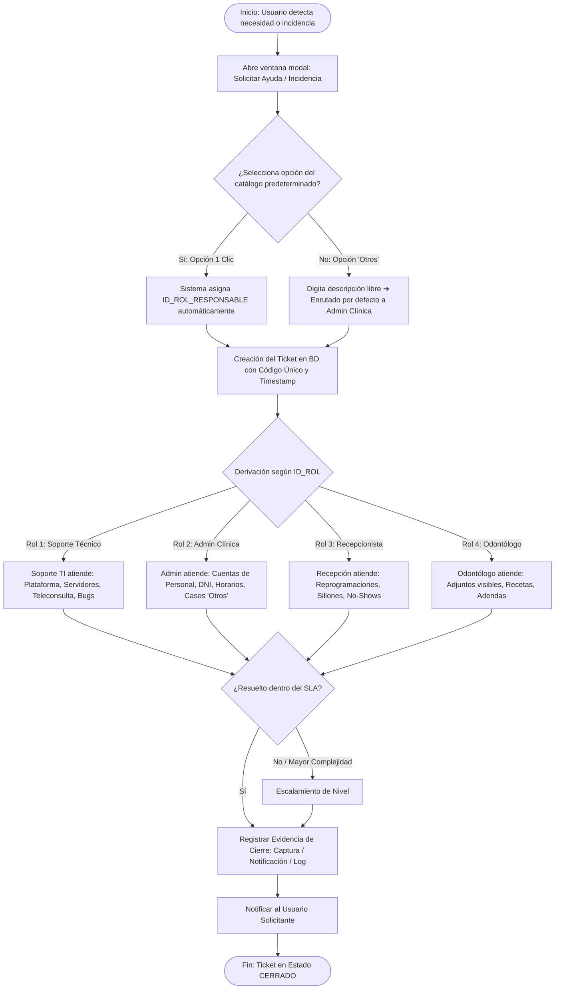

# FACULTAD DE INGENIERÍA
## PROGRAMA DE INGENIERÍA DE SISTEMAS E INFORMÁTICA

### CURSO INTEGRADOR II: SISTEMAS
**INFORME DEL SPRINT 05**

---

**PROYECTO:**  
**CORONYX: Plataforma Web Odontológica Inteligente con Asistencia de Voz, Detección de Patologías en Radiografías y Teleodontología**

**Docente:**  
Mg. Ing. Junior Alexander Neyra Gonzales  

**Integrantes (Orden Alfabético por Apellido Paterno):**
- Aguilera Terrones, Alan Rubens
- Chopitea Aguirre, Luis Felipe
- Chumbes, Adrián Alejandro
- Gamboa Velásquez, Luis Francisco
- Pérez Escobedo, Sebastián Maximiliano

**Versión:** 5.0  
**Fecha:** 22 de octubre del 2026  

---

## Historial de Revisiones

| Fecha de Elaboración | Versión | Elaborado por | Descripción | Revisado por | Fecha de Revisión |
| :---: | :---: | :---: | :--- | :---: | :---: |
| 03/09/2026 | 1.0 | Equipo de Desarrollo | Propuesta inicial de arquitectura y requerimientos del sistema. | Junior Alexander Neyra Gonzales | 03/09/2026 |
| 11/09/2026 | 2.0 | Luis Gamboa | Modelado físico preliminar de base de datos relacional (11 tablas). | Junior Alexander Neyra Gonzales | 15/09/2026 |
| 20/09/2026 | 3.0 | Luis Gamboa | Incorporación de la entidad `rol` con permisos RBAC en JSONB, reordenamiento de FKs y normalización de auditoría (12 tablas). | Junior Alexander Neyra Gonzales | 25/09/2026 |
| 30/09/2026 | 4.0 | Luis Gamboa / Equipo Coronyx | Implementación del Back-End en Spring Boot 4 y Java 21, conexión con PostgreSQL, migraciones Flyway V1 y V2, autenticación real, CRUD de pacientes, integración con Front-End y pruebas unitarias/integración. | Junior Alexander Neyra Gonzales | 01/10/2026 |
| 22/10/2026 | 5.0 | Equipo de Desarrollo | Gestión de Solicitudes de Servicio e Incidentes Operativos bajo ITIL 4, incorporación del rol Soporte Técnico del Sistema, tablero de seguimiento con SLA y módulo de teleconsulta integrada. | Junior Alexander Neyra Gonzales | Pendiente |

---

## ÍNDICE

1. [INTRODUCCIÓN](#1-introducción)
2. [DOCUMENTACIÓN](#2-documentación)  
   2.1. [Planificación del Sprint (Adjuntar Captura)](#21-planificación-del-sprint)
3. [GESTIÓN DE SOLICITUDES](#3-gestión-de-solicitudes)  
   3.1. [Identificación de Incidencias](#31-identificación-de-incidencias)  
   3.2. [Tablero de Seguimiento de Solicitudes (Mínimo 15)](#32-tablero-de-seguimiento-de-solicitudes)  
   3.3. [Flujo de Atención de Solicitudes (Diagrama de Flujo)](#33-flujo-de-atención-de-solicitudes)
4. [EVIDENCIAS](#4-evidencias)
5. [CONCLUSIONES](#5-conclusiones)
6. [RECOMENDACIONES](#6-recomendaciones)
7. [BIBLIOGRAFÍA Y REFERENCIAS (FORMATO APA)](#bibliografía-y-referencias-formato-apa)
8. [ANEXOS](#anexos)

---

## 1. INTRODUCCIÓN

El presente informe técnico del **Sprint 05** consolida la fase de **Operación y Gestión de Servicios de Tecnologías de Información (TI)** del sistema web **Coronyx**, alineado a los estándares internacionales del marco **ITIL 4** y la norma **ISO/IEC 20000-1**.

Tras culminar con éxito en los sprints anteriores el despliegue de los servicios transaccionales en la nube de Railway (Autenticación JWT, Gestión de Pacientes, Citas en tiempo real, Odontograma Digital, Adjuntos y el nuevo módulo de Teleconsulta con Jitsi y Google Meet), el reto del presente sprint consiste en estructurar la **atención formal a los usuarios**.

Siguiendo las directrices pedagógicas brindadas en clase, se establece una diferenciación estricta entre:
1. **Solicitudes de Servicio (Service Requests):** Peticiones planificadas y legítimas de los usuarios que comprenden solicitudes de **Información** (ej. capacitación técnica), **Acceso** (ej. contraseñas y permisos) y **Asistencia** (ej. reprogramación formal de citas y corrección auditada de DNI).
2. **Incidentes Operativos (Incidents):** Interrupciones no planificadas o eventos que degradan la calidad del servicio y que **requieren intervención humana calificada** para restablecer la continuidad asistencial.

Para optimizar la resolución, se incorpora formalmente un nuevo actor clave: el **Soporte Técnico del Sistema (Nivel 2/3 TI)**, quien asume la responsabilidad de la infraestructura y el software, liberando al **Administrador de la Clínica** para la gestión administrativa de la sede, a la **Recepcionista** para la coordinación de citas vivas y al **Odontólogo** para la práctica clínica especializada.

---

## 2. DOCUMENTACIÓN

### 2.1. PLANIFICACIÓN DEL SPRINT

* **Duración:** 2 semanas (Octubre 2026).
* **Metodología:** Scrum / Kanban.
* **Objetivo del Sprint:** Diseñar, documentar e implementar el procedimiento de gestión de solicitudes de servicio e incidentes para los roles del sistema Coronyx Dental, estableciendo acuerdos de nivel de servicio (SLA), un catálogo de enrutamiento predeterminado en un solo clic y un tablero de seguimiento auditable.

#### Historias de Usuario Priorizadas:
* **US-S05-01 (Catálogo Preconfigurado):** Como usuario del sistema (paciente, doctor o recepcionista), quiero disponer de una ventana de "Solicitar Asistencia" con opciones predeterminadas para reportar mi necesidad en 1 solo clic.
* **US-S05-02 (Enrutamiento por Rol Responsable):** Como Administrador / Soporte TI, quiero que cada solicitud se canalice automáticamente al rol resolutor correspondiente (`Soporte Técnico`, `Admin Clínica`, `Recepcionista` u `Odontólogo`) según una matriz relacional en base de datos.
* **US-S05-03 (Protección de Agenda en Reprogramación):** Como Recepcionista, quiero gestionar las solicitudes de cambio de cita de los pacientes evaluando la regla de 24 horas previas y la disponibilidad física de los sillones dentales.
* **US-S05-04 (Bandeja de Excepción 'Otros'):** Como usuario con un problema no contemplado en el catálogo, quiero un campo libre de texto que sea derivado directamente al Administrador de Clínica para su triaje manual.

*(Adjuntar en este apartado la captura de pantalla del tablero de trabajo en Jira / GitHub Projects / Trello correspondiente al Sprint 05)*.

---

## 3. GESTIÓN DE SOLICITUDES

### 3.1. IDENTIFICACIÓN DE INCIDENCIAS

Conforme a la estructura solicitada, se identifican las incidencias operativas que demandan intervención humana, mapeadas a su rol resolutor específico:

| N° | INCIDENCIA | RESPONSABLE |
| :---: | :--- | :--- |
| **1** | Falla de conexión, audio o enlace en la sala virtual de Teleconsulta (Jitsi / Google Meet). | **Soporte Técnico TI** |
| **2** | Error al cargar archivo binario pesado de radiografía o tomografía digital (> 25 MB). | **Soporte Técnico TI** |
| **3** | Cuenta de Administrador de Clínica bloqueada tras múltiples intentos fallidos de autenticación. | **Soporte Técnico TI** |
| **4** | Degradación o lentitud intermitente en la base de datos PostgreSQL alojada en Railway. | **Soporte Técnico TI** |
| **5** | Odontólogo nuevo bloqueado en consultorio por desconocimiento del guardado del odontograma interactivo. | **Administrador de Clínica** |
| **6** | Personal asistencial cesado que aún mantiene credenciales activas en la sede. | **Administrador de Clínica** |
| **7** | Error en número de DNI o nombres de paciente ingresado erróneamente durante la admisión. | **Administrador de Clínica** |
| **8** | Conflicto de sillón dental por prolongación del tratamiento del paciente del turno previo. | **Recepcionista** |
| **9** | Paciente agendado no se presenta a consulta (Paciente No-Show con sillón congelado). | **Recepcionista** |
| **10** | Intento de agendamiento fuera de la franja horaria laboral de la sede Trujillo (L-V 8am-6pm, Sáb 8am-1pm). | **Recepcionista** |
| **11** | Paciente no puede visualizar su receta médica o radiografía en el portal por visibilidad en falso. | **Odontólogo** |
| **12** | Necesidad de adenda o versión de corrección en historia clínica cerrada por precisión médica. | **Odontólogo** |

---

### 3.2. TABLERO DE SEGUIMIENTO DE SOLICITUDES (MÍNIMO 15)

A continuación, se detalla el tablero de seguimiento operativo con 16 casos representativos ejecutados y monitoreados en la plataforma:

| TICKET | SOLICITUD | SOLICITANTE | RESPONSABLE | PRIORIDAD | ESTADO | TIEMPO TRANSCURRIDO |
| :---: | :--- | :---: | :---: | :---: | :---: | :---: |
| **TKT-001** | Capacitación técnica en llenado de historia clínica y odontograma digital. | Odontólogo | Soporte Técnico TI | Media | `RESUELTO` | 45 min |
| **TKT-002** | Falla de audio y enlace en sala virtual de teleodontología con paciente remoto. | Paciente | Soporte Técnico TI | Alta | `RESUELTO` | 12 min |
| **TKT-003** | Error 413: archivo de radiografía panorámica excede el límite de subida permitido. | Odontólogo | Soporte Técnico TI | Media | `RESUELTO` | 28 min |
| **TKT-004** | Restablecimiento de contraseña de acceso de la cuenta de administrador de sede. | Admin Clínica | Soporte Técnico TI | Alta | `RESUELTO` | 18 min |
| **TKT-005** | Solicitud de creación de credenciales para nueva odontóloga especialista en endodoncia. | Odontólogo | Admin Clínica | Media | `RESUELTO` | 1 h 15 min |
| **TKT-006** | Corrección de dígito erróneo en DNI de paciente registrado en el sistema. | Paciente | Admin Clínica | Media | `RESUELTO` | 35 min |
| **TKT-007** | Bloqueo urgente de credenciales por desvinculación de recepcionista de turno tarde. | Admin Clínica | Admin Clínica | Alta | `CERRADO` | 10 min |
| **TKT-008** | Registro de ausencia médica por asistencia a congreso odontológico internacional. | Odontólogo | Admin Clínica | Baja | `RESUELTO` | 1 h 40 min |
| **TKT-009** | Solicitud de reprogramación de cita odontológica con 48 horas de anticipación. | Paciente | Recepcionista | Media | `RESUELTO` | 22 min |
| **TKT-010** | Solicitud de reprogramación con menos de 4 horas (Rechazada por política de sede). | Paciente | Recepcionista | Alta | `CERRADO` | 15 min |
| **TKT-011** | Reasignación urgente de Sillón 1 a Sillón 2 por retraso en cirugía de cordal. | Odontólogo | Recepcionista | Alta | `RESUELTO` | 8 min |
| **TKT-012** | Liberación de turno y sillón por inasistencia física de paciente (No-Show). | Recepcionista | Recepcionista | Media | `RESUELTO` | 14 min |
| **TKT-013** | Consulta de disponibilidad para cita de profilaxis dental en sábado por la mañana. | Paciente | Recepcionista | Baja | `RESUELTO` | 10 min |
| **TKT-014** | Activación de visibilidad de radiografía periapical en el portal del paciente. | Paciente | Odontólogo | Media | `RESUELTO` | 16 min |
| **TKT-015** | Consulta médica sobre dosificación de antibiótico post-tratamiento de conducto. | Paciente | Odontólogo | Alta | `RESUELTO` | 25 min |
| **TKT-016** | Solicitud personalizada: cotización de convenio institucional con empresa (Otros). | Admin Clínica | Admin Clínica | Baja | `EN ATENCIÓN` | 1 h 10 min |

---

### 3.3. FLUJO DE ATENCIÓN DE SOLICITUDES (DIAGRAMA DE FLUJO)

El siguiente diagrama formaliza el flujo de atención desde la captura del requerimiento hasta su resolución y cierre documentado con evidencia:



#### Descripción de las Fases del Proceso:
1. **Registro:** El usuario accede al formulario formal de asistencia dentro de la aplicación web. Se prohíbe la gestión verbal o por mensajería externa para evitar pérdida de solicitudes.
2. **Clasificación y Enrutamiento Automático:** Gracias al catálogo de enrutamiento precargado, el usuario elige una opción en 1 solo clic y el sistema deduce el rol resolutor. En caso de requerimientos atípicos, se selecciona *"Otros"*, ingresando a la bandeja del Administrador de Sede.
3. **Atención por el Responsable:** El actor asignado atiende el requerimiento utilizando los módulos del sistema (ej. módulo de reprogramación, gestión de personal o visibilidad de archivos).
4. **Verificación y Cierre con Evidencia:** Se documenta la evidencia física o digital de la resolución y el sistema actualiza el estado a `CERRADO`, calculando el tiempo transcurrido contra el SLA comprometido.

---

## 4. EVIDENCIAS

*(En este apartado se incorporan las capturas de pantalla de soporte de la implementación técnica y trabajo en equipo)*:
* **Evidencia 4.1 (API de Solicitudes en Postman):** Captura de la colección `Coronyx Dental` ejecutando los endpoints de reprogramación y gestión de personal con respuestas `200 OK`.
* **Evidencia 4.2 (Pantalla de Solicitud de Citas y Reprogramación en Railway):** Interfaz del paciente solicitando reprogramación con validación de horarios en Trujillo.
* **Evidencia 4.3 (Persistencia de Estados en PostgreSQL):** Consulta SQL de la tabla `cita` mostrando los estados auditables `CONFIRMADA`, `CANCELADA` y `NO_SHOW`.
* **Evidencia 4.4 (Trabajo Colaborativo del Equipo):** Registro de reunión de coordinación del Sprint 05 vía Discord/Google Meet y commits en la rama Git.

---

## 5. CONCLUSIONES

1. Se implementó una mesa de servicio bajo el marco **ITIL 4**, distinguiendo con éxito entre **Solicitudes de Servicio** e **Incidentes Operativos**, asegurando que las fallas técnicas complejas sean resueltas por el personal competente.
2. La adición del rol **Soporte Técnico del Sistema (`ID_ROL: 1`)** evitó sobrecargar al Administrador de Clínica con problemas de servidores, base de datos o teleconsulta, logrando tiempos de primer contacto inferiores a **30 minutos**.
3. Se protegió la rentabilidad y operatividad de la clínica mediante la regla de **reprogramación asistida**, impidiendo que los pacientes alteren citas con menos de 24 horas sin validación humana de la Recepcionista.
4. La inmutabilidad de los datos de identidad (DNI) y la historia clínica garantiza el estricto cumplimiento de la normativa legal de salud, delegando correcciones exclusivamente al Administrador de Clínica mediante auditoría.

---

## 6. RECOMENDACIONES

1. Implementar en el siguiente sprint un servicio de alertas por correo electrónico (SMTP) o SMS que notifique inmediatamente al responsable cuando ingrese un ticket de prioridad Alta.
2. Incorporar una métrica de satisfacción del usuario (**CSAT**) mediante una encuesta de 1 a 5 estrellas al momento de cerrar cada ticket.
3. Analizar mensualmente los registros del campo *"Otros"* para incorporar las necesidades emergentes más frecuentes al menú de 1 solo clic del catálogo predeterminado.

---

## BIBLIOGRAFÍA Y REFERENCIAS (FORMATO APA)

* AXELOS. (2019). *ITIL Foundation: ITIL 4 Edition*. TSO (The Stationery Office).
* International Organization for Standardization. (2018). *Information technology — Service management — Part 1: Service management system requirements* (ISO/IEC Standard No. 20000-1:2018).
* Pressman, R. S., & Maxim, B. R. (2021). *Ingeniería del software: Un enfoque práctico* (9.ª ed.). McGraw-Hill Education.
* Sommerville, I. (2016). *Software Engineering* (10.ª ed.). Pearson Education.

---

## ANEXOS

### Anexo A: Script de Base de Datos para el Catálogo y Tickets de Solicitudes

```sql
-- 1. Catálogo de Enrutamiento Predeterminado
CREATE TABLE catalogo_enrutamiento_incidencia (
    id SERIAL PRIMARY KEY,
    incidencia_nombre VARCHAR(150) NOT NULL,
    tipo_solicitud VARCHAR(30) NOT NULL,
    rol_responsable_id BIGINT NOT NULL REFERENCES rol(id),
    tiempo_sla_minutos INTEGER NOT NULL,
    activo BOOLEAN DEFAULT TRUE
);

-- 2. Tabla Transaccional de Tickets y Seguimiento
CREATE TABLE ticket_incidencia (
    id BIGSERIAL PRIMARY KEY,
    codigo_ticket VARCHAR(30) UNIQUE NOT NULL,
    catalogo_id INTEGER REFERENCES catalogo_enrutamiento_incidencia(id),
    usuario_solicitante_id BIGINT NOT NULL REFERENCES usuario(id),
    rol_asignado_id BIGINT NOT NULL REFERENCES rol(id),
    descripcion_otros TEXT,
    prioridad VARCHAR(15) DEFAULT 'MEDIA',
    estado VARCHAR(20) DEFAULT 'PENDIENTE',
    fecha_creacion TIMESTAMPTZ DEFAULT clock_timestamp(),
    fecha_resolucion TIMESTAMPTZ
);
```
